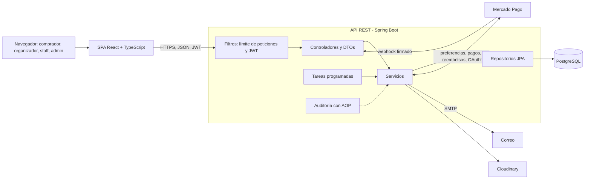
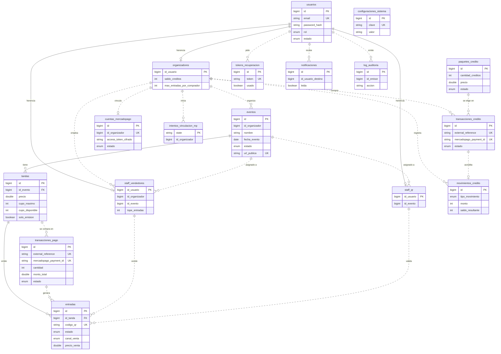
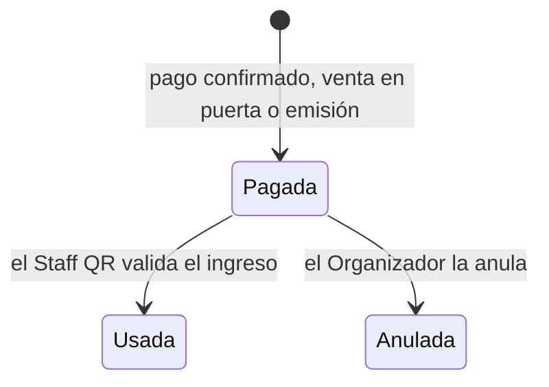

# AsistíAPP — Arquitectura y modelo de datos actuales

Diagramas armados a partir del código (`master`, commit `420f2e2`, 27/11/2026). Los diagramas en PNG de `docs/entrega/` son de la etapa de diseño y se conservan como se entregaron.

## 1. Componentes

| Pieza | Demo online | Local |
|---|---|---|
| Frontend | Vercel | Vite en `localhost:5173` |
| Backend | Render (Docker) | Maven en `localhost:8080` |
| Base | Neon | PostgreSQL |
| Correo | Brevo | MailHog |

## 2. Capas del backend

| Paquete | Responsabilidad |
|---|---|
| `controllers` | Reciben el pedido, validan el DTO y exigen el rol. |
| `services` | Reglas de negocio y transacciones. |
| `repositories` | Acceso a datos con Spring Data JPA; bloqueos pesimistas. |
| `models` | Entidades, enums y DTOs. |
| `security` | JWT, límite de peticiones y auditoría. |
| `config` | Configuración y arranque. |
| `exceptions` | Errores de negocio y manejador global. |

## 3. Modelo de datos

Línea continua: relación mapeada en JPA o por herencia. Línea punteada: relación lógica, guardada como un número sin clave foránea.

## 4. Estados

| Enum | Valores |
|---|---|
| Rol | `Administrador`, `Organizador`, `Staff_QR`, `Staff_Vendedor` |
| Usuario | `Activo`, `Suspendido`, `Inactivo` |
| Evento | `Borrador`, `Publicado`, `Cancelado` ("finalizado" se calcula: 12 horas después del inicio) |
| Entrada | `Pagada`, `Usada`, `Anulada` |
| Orden de pago | `Pendiente`, `Aprobada`, `Rechazada`, `Expirada`, `Reembolsada` |
| Movimiento de créditos | `Bienvenida`, `Recarga`, `Consumo_Publicacion`, `Consumo_Tanda`, `Devolucion_Tanda` |
| Canal de venta | `Online`, `Manual` |

## 5. Identificadores

Las claves primarias son números `Long` autoincrementales (`intentos_vinculacion_mp` usa su `state`). Lo que sale del sistema usa valores no adivinables: `codigo_qr` (texto `QR-` seguido de un UUID sin guiones) y `external_reference` de las órdenes (UUID).
