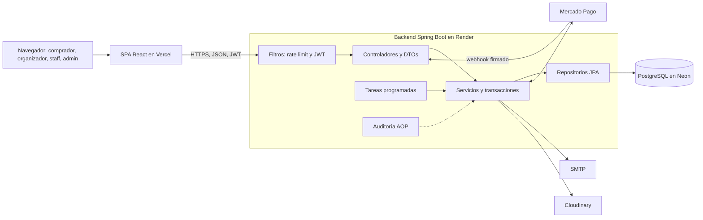

# AsistíAPP — Fase 1: relevamiento

Fecha: 27/11/2026. Código relevado: rama `master`, commit `420f2e2` (igual al desplegado en la demo).

Etiquetas: **[DOCUMENTADA]** figura en un documento o commit · **[INFERIDA]** lo deduzco yo · **[A CONFIRMAR]** falta evidencia.

## Actualización (27/11, con la especificación de casos de uso)

- **La tabla 3.1 quedó superada.** Miraba que cada caso de uso existiera. Al comparar paso por paso: **17 coinciden, 10 tienen diferencias y 1 (CU-022) no está implementado.** Detalle en `docs/proyecto/PLANIFICADO_VS_CONSTRUIDO.md`.
- **Contradicción nueva en el código (C18):** `CLAUDE.md` pide que las llamadas a Mercado Pago vayan fuera de las transacciones, pero `VentaService.iniciarCompraOnline` es `@Transactional` y creaba la preferencia adentro (igual `CreditoService.iniciarCompraCredito`). **Corregida el 27/11**: la orden se guarda antes y Mercado Pago se llama sin transacción; de paso se corrige que la marca de cuenta revocada se perdía por el rollback. Prueba: `CompraFueraDeTransaccionTest`; 608 pruebas de backend en verde.
- **C20, corregida el 27/11**: dos o más validaciones simultáneas del mismo QR resultaban válidas. Se reprodujo con `StaffQRConcurrencyTest` (8 de 8 puertas aceptaban) y ahora se marca con un `UPDATE` condicionado a que la entrada siga `Pagada`. 610 pruebas de backend y 4 de punta a punta en verde.
- **C21, sin corregir (leída en el código, sin reproducir):** si el organizador anula o reembolsa una entrada en el mismo instante en que se escanea, `AnulacionEntradaService` puede pisar el ingreso ya registrado.
- **C22, sin corregir (leída en el código, sin reproducir):** `CreditoLedgerService` lee el saldo, suma y guarda sin bloqueo ni versión: dos operaciones simultáneas del mismo organizador podrían pisarse.
- **C23, sin corregir (leída en el código, sin reproducir):** `TandaService.actualizarTanda` no bloquea la tanda: editarla en el mismo instante de una venta podría reponer el cupo descontado.
- **C24 (leída en el código, sin probar):** un reembolso hecho desde el panel de Mercado Pago no cambia una orden ya aprobada ni anula sus entradas (`VentaService.marcarOrdenReembolsada`).
- **C25 (verificada en la base local):** `mercadopago_payment_id` está declarado único pero la restricción no existe en una base creada antes (`ddl-auto` no la agrega); además solo hay 5 claves foráneas.
- **C26:** `docs/tecnica/SECURITY.md` dice que toda modificación de cupo o de saldo de créditos corre con bloqueo pesimista; el saldo de créditos y la edición de tandas no lo tienen (C22, C23). Sin resolver.
- **C27:** `DECISIONES.md` (20/11) dice que términos y privacidad fueron revisados por un abogado y son definitivos; en `LEGAL_Y_FISCAL.md` la reunión con un abogado sigue sin marcar y `/privacidad` dice que la conservación de datos "se define con asesoramiento legal". Además ese documento lista como pendiente cifrar los tokens de Mercado Pago, que ya está hecho. El 27/11 el equipo confirmó la revisión del abogado; los documentos siguen sin actualizar.
- **C19, resuelta:** la fecha 2025 de la especificación de casos de uso es un error; es de 2026. Falta corregirla en el documento original y revisar la del formulario de encuestas.
- Respuestas del equipo: evalúan 3 profesores desarrolladores; 40 minutos en total; demo online con sandbox; Claude Code y Antigravity; roles formales (cada uno tomó tareas a elección); IA permitida, documentando su uso.

---

## 1. Inventario

### 1.1 Qué revisé

| Material | Dónde | Profundidad |
|---|---|---|
| PP2 (problema, objetivos, metodología, roles, 28 CU) | `docs/entrega/` | Leído |
| Diagramas de casos de uso (Sistema y Autenticación) | `docs/entrega/` | Leídos |
| Planilla Scrum (backlog, sprints, horas) | `docs/entrega/` | Leída |
| Diagramas de arquitectura, de tablas y DER | `docs/entrega/` | Leídos |
| `README.md`, `API.md`, `SECURITY.md`, `DEPLOY_DEMO.md`, `GUIA_DEMO.md` | raíz y `docs/tecnica/` | Leídos (líneas largas recortadas) |
| `DECISIONES.md`, `PLAN_MEJORAS.md`, `MODELO_DE_COBRO.md`, `LEGAL_Y_FISCAL.md`, `GUIA_REDISENO.md` | `docs/proyecto/`, `frontend/` | Leídos (líneas largas recortadas) |
| `MERCADOPAGO_COBRO.md` (pruebas, sandbox, pendientes) y propuesta de integración (.docx) | `docs/tecnica/` | Parcial |
| Planes de implementación de backend y frontend, `DESIGN.md`, `CONTINUAR.md` | `docs/` | Parcial o por búsqueda |
| Código: paquetes, entidades, enums, endpoints, seguridad, rutas del frontend | `backend/`, `frontend/` | Listado y búsquedas dirigidas, no línea por línea |
| Configuración: `pom.xml`, `package.json`, `application.yml`, Dockerfile, docker-compose, CI | repo | Leída |
| Historial de Git (todas las ramas): autores, fechas, mensajes | repo | Revisado |
| TP de Derecho "AsistíAPP S.A.S.", su presentación y guía de preguntas | `Downloads/` (fuera del repo) | Parcial |
| TPs, presentación y guía de Ética | `Documentos/facu/` (fuera del repo) | Parcial |
| Instrumentos de encuestas y entrevistas | `Documentos/facu/` | Leídos |

### 1.2 Qué no pude acceder o no encontré

- **Código de ética del proyecto:** no apareció en el repo, `Documentos`, `Downloads` ni `Escritorio` (búsqueda por nombre y por texto en lo extraído). Los TPs de Ética encontrados son ensayos sobre "¿Es productiva la ética en el mundo digital?" y no mencionan AsistíAPP.
- **Especificación detallada de los casos de uso** y **mockups de Figma:** el PP2 solo trae enlaces.
- **Resultados de encuestas y entrevistas:** solo encontré los formularios.
- **Consigna o criterios de evaluación de la defensa:** no está. `Exposicion-Final-Consigna.pdf` es de otra materia (RAG, Desarrollo con IA).
- **No abrí a propósito:** volcados de la base, archivos con contraseñas o variables de entorno.
- **No abrí sin permiso:** el historial local de sesiones de Claude Code (2 archivos, desde el 16/08) y de Antigravity/Gemini (hay registros que mencionan el proyecto, con fecha 13/08).
- `GUIA_DEFENSA*` en `Downloads` son de otro proyecto (sistema de turnos médicos).

---

## 2. Stack y arquitectura

### 2.1 Stack real

| Capa | Tecnología |
|---|---|
| Backend | Java 17, Spring Boot 3.3.2 (Web, Security, Data JPA, Validation, Mail, AOP), Maven, Lombok |
| Seguridad | JWT (jjwt 0.12.6, 24 h), BCrypt, límite de peticiones con Bucket4j (en memoria) |
| Datos | PostgreSQL; esquema con `ddl-auto: update` y 14 scripts SQL manuales |
| QR | Generación con ZXing 3.5.3; lectura con html5-qrcode 2.3.8 |
| Integraciones | Mercado Pago (Checkout Pro y OAuth), SMTP, Cloudinary; mapa con Leaflet |
| Frontend | React 19, TypeScript, Vite, Tailwind CSS 4, react-router 7, Recharts, ExcelJS, lucide-react, sonner |
| Pruebas | Backend: JUnit, H2, GreenMail, spring-security-test. Frontend: Vitest, Testing Library, Playwright, oxlint |
| CI | GitHub Actions: un flujo para backend y otro para frontend, en push y PR a `master` |
| Despliegue (demo) | Vercel (frontend), Render con Docker (backend), Neon (base), Brevo (mails) |
| Local | docker-compose solo para MailHog |

No hay aplicación móvil: es una web responsive.

### 2.2 Arquitectura detectada

Cliente-servidor: una SPA que consume una API REST sin estado, y un backend **monolítico en capas**.

| Paquete (`com.asistiapp.backend`) | Archivos |
|---|---|
| `controllers` | 22 |
| `services` | 39 |
| `repositories` | 17 |
| `models` (17 entidades, enums y otros) | 93 |
| `security` | 11 |
| `config` / `exceptions` | 7 / 6 |

Frontend: `pages/{buyer, organizador, staff, admin, ayuda, legal, dev}`, `components`, `lib`, `styles`.

Piezas clave para la defensa:
- Bloqueo pesimista en tandas y órdenes contra la sobreventa (`TandaRepository`, `TransaccionPagoRepository`, `TransaccionCreditoRepository`).
- El pago se vuelve a consultar a Mercado Pago antes de entregar; hay reconciliación y job de vencimiento cada 10 minutos (`VencimientoOrdenesJob`).
- El filtro JWT recarga al usuario en cada pedido: una cuenta suspendida deja de entrar sin esperar que venza el token (`JwtAuthenticationFilter`).
- IDs `Long` autoincrementales; código QR `String` (`"QR-"` + UUID sin guiones, `VentaService`).

### 2.3 Módulos

Autenticación · Eventos y tandas · Catálogo y compra · Pagos Mercado Pago · Créditos · Staff · Venta en puerta · Validación QR · Métricas · Administración · Notificaciones · Auditoría · Perfil, soporte, ayuda y legales.

---

## 3. Funcionalidades según estado

"Implementada" significa que existen el código y la pantalla o endpoint. No volví a ejecutar cada flujo en esta fase.

### 3.1 Los 28 casos de uso (numeración del PP2)

| CU | Nombre | Estado | Respaldo |
|---|---|---|---|
| 001 | Iniciar sesión | Implementada | `POST /auth/login` |
| 002 | Registrar organizador | Implementada | `POST /auth/register` |
| 003 | Recuperar contraseña | Implementada | `/auth/recuperar-password`, `/auth/restablecer-password` |
| 004 | Cerrar sesión | Implementada en el cliente (el token no se invalida en el servidor) | `lib/auth.tsx` |
| 005 | Crear Staff QR | Implementada | `POST /organizador/staff/qr` |
| 006 | Crear Staff Vendedor | Implementada | `POST /organizador/staff/vendedor` |
| 007 | Crear evento | Implementada | `POST /eventos` |
| 008 | Modificar evento | Implementada | `PUT /eventos/{id}` |
| 009 | Tandas y cupos | Implementada | `/eventos/{eventoId}/tandas` |
| 010 | Publicar evento | Implementada | `PATCH /eventos/{id}/publicar` |
| 011 | Cancelar evento | Implementada | `PATCH /eventos/{id}/cancelar` |
| 012 | Métricas en tiempo real | Implementada por consulta periódica (20 s) en el panel; no hay WebSockets | `DashboardPage.tsx` |
| 013 | Historial de créditos | Implementada | `/creditos/historial` |
| 014 | Comprar créditos | Implementada | `POST /creditos/comprar` |
| 015 | Listado de eventos | Implementada | `GET /public/eventos` |
| 016 | Detalle de evento | Implementada | `GET /public/eventos/{urlPublica}` |
| 017 | Comprar entradas | Implementada | `POST /tickets/comprar-online`, webhook |
| 018 | Escanear y validar QR | Implementada | `POST /tickets/validate` |
| 019 | Venta manual | Implementada | `POST /tickets/venta-manual` |
| 020 | Suspender / activar usuario | Implementada | `/admin/usuarios/{id}/suspender`, `/activar` |
| 021 | Eliminar usuario | Implementada | `DELETE /admin/usuarios/{id}` |
| **022** | **Reasignar rol** | **No implementada** (no hay endpoint ni pantalla) | — |
| 023 | Editar evento (Admin) | Implementada | `PUT /admin/eventos/{id}` |
| 024 | Cancelar evento (Admin) | Implementada | `PATCH /admin/eventos/{id}/cancelar` |
| 025 | Eliminar evento (Admin) | Implementada | `DELETE /admin/eventos/{id}` |
| 026 | Precios de créditos | Implementada | `/admin/paquetes-credito`, `/admin/configuraciones` |
| 027 | Métricas globales | Implementada | `/admin/metricas` |
| 028 | Configuraciones | Implementada | `/admin/configuraciones` |

**Resultado: 27 de 28 implementados; CU-022 no.**

### 3.2 Implementado además de los 28 CU

Cuenta de Mercado Pago propia del organizador (OAuth) · anulación y reembolso, individual y masivo · cargo por procesamiento opcional · emisión de cortesías y cobros por fuera · tanda de cortesía · tope por vendedor y por comprador · notificaciones y anuncios · auditoría · exportación a Excel · soporte configurable · botón de arrepentimiento · términos y privacidad · centro de ayuda `/ayuda` · mapa · carga de imágenes · modo claro y oscuro · pruebas de punta a punta.

### 3.3 Parcial o con salvedades

| Tema | Salvedad |
|---|---|
| Cobro con la cuenta del organizador | [DOCUMENTADA] Probado con dinero real el 17/11 (`MERCADOPAGO_COBRO.md`). No se puede probar en sandbox y **la demo online cobra con la cuenta de la plataforma** (`MP_EXIGIR_CUENTA_VINCULADA=false`). |
| Reembolso masivo y revocación de la cuenta | [DOCUMENTADA] Masivo probado con una compra; faltan varias con una fallida. La revocación solo tiene tests. |
| Firma del webhook | [DOCUMENTADA] Resuelta el 20/11; falta comprobarla en producción con un pago de bajo monto. |
| Límite de peticiones | En memoria: se reinicia y no sirve con varias instancias. |
| Legal y fiscal | [DOCUMENTADA] Términos revisados por un abogado; faltan AAIP y contador. |
| Despliegue | Solo demo gratuita; el backend tarda 30–60 s en despertar. |
| Pruebas | Última corrida (26/11): backend 604, frontend 449, 4 de punta a punta. No las repetí hoy. |

### 3.4 Solo planificado o no hecho

Migraciones con Flyway · claves foráneas reales en las relaciones que hoy son un número suelto · límite de peticiones distribuido · dominio propio con SPF, DKIM y DMARC · producción real · reasignación de rol · carrito de varias tandas · historial de compras del comprador (descartado, [DOCUMENTADA] `DECISIONES.md` 22/10) · otros medios de pago (el enum tiene Transferencia, Tarjeta y WhatsApp, pero el código solo usa MercadoPago).

---

## 4. Contradicciones (no las resolví)

| # | Una fuente dice | Otra dice | Riesgo |
|---|---|---|---|
| C1 | PP2: 28 CU con una numeración | La planilla Scrum usa otros números y nombres; el diagrama de casos de uso agrupa distinto (24) | Alto |
| C2 | Scrum: "Carrito de compras" figura **Listo** | No hay carrito: se compran varias entradas de una sola tanda | Alto |
| C3 | PP2: CU-022 Reasignar rol | No existe en el código | Alto |
| C4 | PP2: 6 meses, sprints de 3 semanas | Planilla: 5 sprints de una semana (24/09 a 28/10). Git: 13/08 a 26/11 | Alto |
| C5 | PP2 y planilla: Riffel pagos, Serovich backend/seguridad, Villarroel frontend, Prono datos | Git: el backend de Mercado Pago lo commitea Villarroel (15/10) y el rediseño del frontend, Riffel (16–25/11). Planilla: tareas aún "En progreso" | Alto |
| C6 | TP de Derecho: 5 integrantes (incluye Francisco Barra) | PP2 y tu pedido: 4 | Medio |
| C7 | "Sin comisión" (PP2, portada) | Existe un cargo opcional al comprador, que cubre la comisión de Mercado Pago y no va a la plataforma | Medio: explicarlo bien |
| C8 | Diagramas de tablas y DER: IDs `INT`, entrada Pagada/Usada, faltan tablas nuevas | Código: `Long`, estado `Anulada`, cuenta MP, notificaciones | Alto si los muestran |
| C9 | Diagrama de arquitectura | No incluye Cloudinary y habla de IPN; hoy se usa el webhook firmado | Medio |
| C10 | `API.md` | Falta `Anulada` y datos nuevos de varias tablas | Medio |
| C11 | `MODELO_DE_COBRO.md`: "decidido, sin implementar" | Está implementado | Bajo |
| C12 | `LEGAL_Y_FISCAL.md`: arrepentimiento y marketplace sin marcar | El botón existe y la vinculación se probó | Bajo |
| C13 | Guías con 274, 304 y 534 tests | Hoy son más | Bajo |
| C14 | PP2: encuestas aplicadas con resultados positivos | Solo encontré formularios vacíos | Alto si preguntan |
| C15 | `GUIA_DEMO.md`: cuenta nueva, crear y publicar | Publicar exige un contacto de arrepentimiento (y la cuenta MP si se exige), y la guía no lo menciona | Alto para la demo |
| C16 | PP2 menciona "TicketPass" (y una versión vieja, otro nombre) | El producto es AsistíAPP | Medio |
| C17 | Tu pedido: "PK BIGINT y UUID `codigoQr`" | `codigoQr` es texto con prefijo `QR-` más un UUID | Bajo: usar la versión del código |

---

## 5. Uso de IA, agentes y diseño (tu pregunta más probable)

Lo que hay como evidencia:

- [DOCUMENTADA] `CLAUDE.md` es el contrato de trabajo del asistente de código (desde el 14/08, editado por los usuarios de Git `Felipe_Prono`, `feliprono01`, `emisero8` y `Fedevillarroel`).
- [DOCUMENTADA] Documentos escritos para agentes: `CONTINUAR.md`, `INTEGRAR_AUDITORIA.md`, `MERCADOPAGO_COBRO.md` (commit `3a20c2e`).
- [DOCUMENTADA] Método: planes por fases, no avanzar sin confirmación, verificación en navegador real (`CLAUDE.md`).
- [DOCUMENTADA] Diseño: maqueta en Figma Make como referencia (`frontend_implementation_plan.md`), reglas en `DESIGN.md`, rediseño "editorial / ticket troquelado" (Fase 14, commits de Riffel).
- [INFERIDA] Hubo uso de Antigravity además de Claude Code (registros locales que no abrí).
- [A CONFIRMAR] Qué herramientas usó cada uno, con qué prompts, qué se aceptó o corrigió y quién revisaba.

**Aviso importante:** `CLAUDE.md` pide que los commits no lleven rastro de la IA (solo uno la menciona). El historial **no sirve para medir cuánto se usó** y no conviene presentarlo así. Si preguntan, recomiendo decirlo de frente: qué hizo la IA, qué decidieron ustedes y cómo lo verificaron.

---

## 6. Preguntas para vos

**Sobre la defensa**
1. ¿Quién evalúa (profesores, tribunal, qué materias) y en qué fecha? ¿La entrega del 01/12 es el mismo día?
2. ¿Los 40 minutos incluyen las preguntas? Si no, ¿cuánto dan?
3. ¿Hay consigna o criterios de evaluación? Pasame el archivo.
4. ¿Reparto quién expone qué? Si no, propongo uno en la Fase 2.
5. ¿La demo en vivo va a ser en la versión online o en local? ¿Quieren pagar con sandbox o con dinero real?

**Uso de IA (necesito respuestas de los cuatro)**

6. ¿Qué herramientas usó cada uno (Claude Code, Antigravity, Figma Make, ChatGPT, otras) y para qué parte?
7. ¿Cómo se repartieron agentes, prompts y diseño? Si guardan prompts reales, pasame ejemplos.
8. ¿Qué le tuvieron que corregir a la IA? Dos o tres casos concretos.
9. ¿La cátedra permite y conoce el uso de IA?
10. ¿Me autorizás a revisar el historial local de Claude Code y de Antigravity de esta PC como evidencia (sin copiar secretos ni datos personales)?

**Equipo y proceso**

11. ¿`feliprono01` y `Felipe_Prono` sos vos, `emisero8` es Emilio y `Fedevillarroel` es Federico? ¿Alguien trabajó desde la máquina o el usuario de otro?
12. ¿Cómo se explica la diferencia entre roles planificados y commits (C5)?
13. ¿Cuál es la cronología real y cómo usaron Scrum (sprints, reuniones, Jira)?
14. ¿Qué rol tiene Francisco Barra?

**Documentos**

15. ¿Qué numeración de casos de uso es la oficial (propongo la del PP2)? ¿Tienen la especificación detallada?
16. ¿Dónde está el código de ética aplicado al proyecto? ¿Hay otro trabajo de Derecho o Legislación además del de la S.A.S.?
17. ¿Las encuestas y entrevistas se hicieron? Pasame los resultados.
18. ¿Tienen los diseños de Figma?
19. ¿CU-022 y el carrito se presentan como no implementados (recomendado) o quieren hacer algo antes?
20. ¿Quieren corregir los diagramas y documentos desactualizados (C8 a C13) antes de la defensa? Sería una tarea aparte: acá no modifico el proyecto.
