# AsistíAPP — Guía de estudio

Para: Felipe Prono, Facundo Riffel, Emilio Serovich y Federico Villarroel.
Código descripto: rama `master` (commit `420f2e2`) más el cambio del 27/11 en el inicio de compra, todavía sin subir.

**Etiquetas de evidencia**

| Etiqueta | Significa | Qué hacer en la defensa |
|---|---|---|
| **[DOCUMENTADA]** | El motivo o el dato figura en un documento o commit, que se cita | Se puede afirmar |
| **[INFERIDA]** | La decisión está en el proyecto; el motivo lo dedujimos al armar la guía | Leerlo y confirmar que es el motivo de ustedes antes de decirlo |
| **[A CONFIRMAR]** | Falta evidencia | No decirlo hasta confirmarlo |

---

## 0. Cómo estudiar esta guía

La guía tiene cuatro partes. **★** marca lo que más esperan que les pregunten.

| Parte | Secciones | Prioridad |
|---|---|---|
| A | 0 a 4: resumen, origen, **arquitectura ★**, **tecnologías ★** | Primero |
| B | 5 y 6: **decisiones de diseño ★** y **uso de IA ★** | Primero |
| C | 7 a 10: base de datos, backend, frontend, flujos | Después |
| D | 11 a 17: **seguridad ★**, integraciones, pruebas, ética, problemas, estado, glosario | Seguridad primero; el resto al final |

Los cuatro estudian todo: no hay temas repartidos.

**Ruta corta (si queda poco tiempo):** 1 → 3 → 4 → 5 → 6 → 11 → 16.

**Cómo usarla**

1. Leé la sección.
2. Abrí en el editor los archivos que cita. Ver el archivo real fija mucho más que leer sobre él.
3. Tapá las respuestas de repaso y contestalas en voz alta.
4. Lo que no puedas explicar con tus palabras, volvé a leerlo.

**Una regla para la defensa:** si no sabés algo, decí cómo lo averiguarías ("está en `SecurityConfig`, lo puedo mostrar"). Es mejor que inventar: evalúan tres desarrolladores.

---

## 1. Resumen

### En palabras simples

AsistíAPP es una página web para vender entradas de eventos y controlarlas en la puerta. El comprador paga y recibe un código QR; el personal del evento lo escanea con el celular y el sistema dice si entra o no. Cada entrada sirve una sola vez.

**Analogía:** es la boletería, el talonario y el portero de un evento en un solo sistema, donde el talonario sabe cuáles entradas ya se usaron.

### El problema

Los organizadores independientes venden por WhatsApp, efectivo o transferencias. [DOCUMENTADA: PP2, 1.1] Eso trae cinco problemas:

| Problema | Ejemplo |
|---|---|
| Sin control ni métricas | No se sabe cuántas entradas quedan |
| Fraude y duplicación | Una captura de pantalla se comparte con varias personas |
| Accesos desordenados | Colas y discusiones en la puerta |
| Mala experiencia de compra | Crear cuentas, dudar de si la entrada vale |
| Sin soluciones accesibles | Las plataformas grandes apuntan a eventos masivos y cobran comisión |

### La solución

- El organizador crea el evento, define tandas con precio y cupo, y lo publica.
- El comprador elige y paga con Mercado Pago, **sin crear cuenta**.
- Le llega por correo la entrada con un QR.
- El Staff QR la valida desde el navegador; el Staff Vendedor vende en la puerta.
- El organizador ve ventas, ingresos y cupo; el administrador gestiona la plataforma.

### Usuarios

| Perfil | Inicia sesión | Qué hace |
|---|---|---|
| Comprador | No | Ve eventos, compra y muestra su QR |
| Organizador | Sí | Eventos, tandas, créditos, staff, métricas, reembolsos |
| Staff QR | Sí | Valida entradas del evento asignado |
| Staff Vendedor | Sí | Vende en la puerta, con un tope fijado por el organizador |
| Administrador | Sí | Usuarios, eventos, precios de créditos, configuración, auditoría |

En el código hay **cuatro roles** (`RolUsuario`: `Administrador`, `Organizador`, `Staff_QR`, `Staff_Vendedor`). El comprador no es un rol porque no tiene usuario.

### Alcance

| Incluye | No incluye |
|---|---|
| Web responsive (celular y computadora) | Aplicación móvil nativa |
| Pago online con Mercado Pago | Otros medios de pago propios (el enum los nombra, pero no están implementados) |
| Una tanda y una cantidad por compra | Carrito de varias tandas |
| Compra sin cuenta | Historial de compras del comprador |
| Demo online gratuita con pagos de prueba | Producción real |

El mercado inicial planteado es Santa Fe y alrededores, y ciudades intermedias del interior. [DOCUMENTADA: PP2, 1.3]

### Como sistema de información

Un **sistema de información** junta datos, los procesa y entrega información para operar y decidir. AsistíAPP hace las dos cosas:

| Nivel | Qué hace en AsistíAPP | Dónde |
|---|---|---|
| Transaccional (el día a día) | Registra ventas, pagos, ingresos y movimientos de créditos | `VentaService`, `StaffQRService`, `CreditoLedgerService` |
| De gestión (para decidir) | El organizador ve ventas por tanda, ingresos y cupo; el administrador ve métricas globales | `MetricasOrganizadorService`, `AdminMetricasService`, exportación a Excel |

Ejemplos de decisiones que permite: abrir una tanda nueva cuando la anterior se agota, ajustar el cupo, reforzar la venta en puerta o revisar qué vendió cada vendedor. [INFERIDA]

**No** es un sistema experto ni predice nada: muestra datos para que decida una persona. [INFERIDA]

### Lo que tenés que saber

- La frase de una línea: "plataforma web de venta de entradas y control de acceso con QR de un solo uso para organizadores independientes".
- Cinco perfiles, cuatro roles con sesión.
- Es transaccional y además da información de gestión.

### Repaso

**1. ¿Qué problema resuelve AsistíAPP?**
La venta informal de entradas: sin control, con fraude por entradas compartidas y accesos desordenados.

**2. ¿Por qué el comprador no es un rol?**
Porque no tiene cuenta. Compra con nombre y correo, y su entrada se identifica por el código QR.

**3. ¿Qué tipo de sistema de información es?**
Principalmente transaccional, con funciones de apoyo a la gestión (métricas y reportes).

**4. ¿Qué quedó fuera del alcance?**
App nativa, carrito de varias tandas, historial del comprador, otros medios de pago y producción real.

---

## 2. Origen y planificación

### La idea y su validación

El proyecto se propuso en Práctica Profesionalizante 2 del Instituto de Estudios Superiores de Santa Fe. [DOCUMENTADA: PP2]

El PP2 afirma que el problema se relevó con una encuesta a compradores, organizadores y vendedores, con resultados que confirmaron los puntos de dolor. [DOCUMENTADA: PP2, 2] El equipo confirma que se hizo, pero **los resultados no están disponibles**: no citen cifras ni porcentajes. [A CONFIRMAR si aparecen antes de la defensa]

### Requisitos

**Objetivo general** [DOCUMENTADA: PP2, 1.2]: gestionar la venta de entradas de forma digital, segura y centralizada, con una compra simple y validación en tiempo real mediante QR de un solo uso.

| Requisito funcional (objetivos del PP2) | Cómo quedó |
|---|---|
| Crear y publicar eventos con tandas, cupos y fechas | Implementado |
| QR de un solo uso validado desde el navegador | Implementado |
| Comprar sin registro previo | Implementado |
| Panel en tiempo real | Implementado con actualización cada 20 segundos |
| Créditos en lugar de comisión porcentual | Implementado |
| Integrar Mercado Pago | Implementado; la demo usa pagos de prueba |
| Usable para distintos niveles de experiencia | Diseño responsive y centro de ayuda; sin pruebas formales con usuarios documentadas |

| Requisito no funcional | Cómo se atiende |
|---|---|
| Seguridad | JWT, roles, contraseñas con BCrypt, límite de peticiones, auditoría |
| No vender de más | Transacciones y bloqueo de la fila de la tanda |
| Accesible desde el celular | Web responsive, escáner en el navegador |

"Requisito funcional" es lo que el sistema hace; "no funcional", cómo tiene que hacerlo.

### Actores

Comprador/Visitante, Organizador, Staff QR, Staff Vendedor y Administrador. [DOCUMENTADA: especificación de casos de uso] Mercado Pago y el servidor de correo son sistemas externos.

### Los 28 casos de uso

Un **caso de uso** describe algo que un actor logra con el sistema, paso por paso y con sus excepciones. La numeración oficial es la de la especificación (`docs/entrega/AsistiAPP - Casos de Uso.pdf`) y el PP2. La planilla Scrum usa otra.

Estado: ✅ coincide con lo especificado · ⚠️ implementado con diferencias · ❌ no implementado.

**Total: 17 ✅ · 10 ⚠️ · 1 ❌** [DOCUMENTADA: `docs/proyecto/PLANIFICADO_VS_CONSTRUIDO.md`, comparación leyendo el código]

#### Autenticación

| CU | Qué logra el actor | Estado | Diferencia |
|---|---|---|---|
| 001 Iniciar sesión | Entra con correo y contraseña y llega al panel de su rol | ✅ | |
| 002 Registrar organizador | Crea su cuenta y recibe créditos de bienvenida | ✅ | Además acepta los términos |
| 003 Recuperar contraseña | Recibe un enlace de un solo uso y con vencimiento | ⚠️ | Si falla el correo, no se le informa |
| 004 Cerrar sesión | Sale y no accede más a lo protegido | ✅ | El token se borra en el navegador |

#### Gestión de Staff

| CU | Qué logra el actor | Estado | Diferencia |
|---|---|---|---|
| 005 Crear Staff QR | El organizador crea la cuenta de quien escanea, ligada a un evento | ⚠️ | Si falla el correo no se avisa; puede restablecer la contraseña y verla |
| 006 Crear Staff Vendedor | Crea la cuenta de quien vende en puerta | ⚠️ | Igual que 005, y además se asigna a un evento con tope de entradas |

#### Gestión de Eventos

| CU | Qué logra el actor | Estado | Diferencia |
|---|---|---|---|
| 007 Crear evento | Guarda un evento en borrador, sin gastar créditos | ✅ | Suma ubicación en mapa |
| 008 Modificar evento | Cambia sus datos; si está publicado se ve al instante | ✅ | Un evento finalizado no se edita |
| 009 Tandas y cupos | Define precios y cupos; cada tanda se controla aparte | ✅ | Suma tandas de cortesía |
| 010 Publicar evento | Lo hace visible y activa su enlace público | ⚠️ | Los créditos de las entradas se descuentan al crear la tanda; publicar cuesta aparte; los cupos se pueden editar; exige contacto y cuenta de Mercado Pago (configurable) |
| 011 Cancelar evento | Frena las ventas | ⚠️ | Desde la hora de inicio el organizador no puede; la página pública muestra un error genérico |

#### Métricas y Créditos

| CU | Qué logra el actor | Estado | Diferencia |
|---|---|---|---|
| 012 Métricas del evento | Ve vendidas, ingresos y cupo | ⚠️ | Se actualiza cada 20 segundos, sin indicador de desconexión |
| 013 Historial de créditos | Ve cada movimiento y el saldo resultante | ⚠️ | Sin filtros por fecha ni tipo |
| 014 Comprar créditos | Paga un paquete y se acredita | ✅ | Usa webhook firmado en lugar de IPN |

#### Comprador

| CU | Qué logra el actor | Estado | Diferencia |
|---|---|---|---|
| 015 Listado de eventos | Ve los eventos publicados | ✅ | |
| 016 Detalle del evento | Ve datos, tandas, precios y disponibilidad | ✅ | |
| 017 Comprar entrada | Paga y recibe su QR | ⚠️ | Solo Mercado Pago; no se reserva cupo: se descuenta al confirmar y, si no hay, se reembolsa |

#### Staff

| CU | Qué logra el actor | Estado | Diferencia |
|---|---|---|---|
| 018 Escanear y validar QR | Acepta o rechaza un ingreso y marca la entrada como usada | ✅ | Suma ingreso manual del código y rechazo de anuladas y eventos cancelados |
| 019 Venta manual | El vendedor emite entradas cobradas por fuera | ✅ | Hasta 20 por venta, con correo |

#### Administrador

| CU | Qué logra el actor | Estado | Diferencia |
|---|---|---|---|
| 020 Suspender o activar usuario | Bloquea o devuelve el acceso | ✅ | |
| 021 Eliminar usuario | Borra una cuenta | ✅ | Bloquea además si tiene vendedores a cargo o compras de créditos |
| 022 Reasignar rol | Cambiar el rol de un usuario | ❌ | No hay pantalla ni endpoint |
| 023 Editar evento | Corrige un evento ajeno | ✅ | |
| 024 Cancelar evento | Cancela un evento ajeno | ✅ | |
| 025 Eliminar evento | Borra un evento | ✅ | Bloquea si hay compras en curso |
| 026 Precios de créditos | Administra los paquetes | ✅ | |
| 027 Métricas globales | Ve el estado de la plataforma | ⚠️ | Sin filtro por fechas ni exportación |
| 028 Configuraciones | Cambia parámetros del sistema | ⚠️ | Un número mal escrito se ignora y se usa el valor por defecto |

**Sobre CU-022:** el 06/10 se quitó la opción "Cambiar Rol" del panel de administración. [DOCUMENTADA: commit "feat: quitar 'Cambiar Rol' del Admin…"] El motivo, indicado por el equipo: **no era necesario**; un organizador nunca va a pasar a ser administrador, ni un Staff QR a organizador. [DOCUMENTADA: respuesta del equipo, 27/11]

Para reforzarlo si repreguntan: cada rol tiene datos propios (créditos del organizador, evento asignado del staff) y convertir uno en otro obligaría a decidir qué pasa con ellos. [INFERIDA] Si alguien necesita otro rol, se crea una cuenta nueva con otro correo.

**Además de los 28** se construyó: cuenta de Mercado Pago propia de cada organizador, anulación y reembolso (individual y masivo), cargo por procesamiento opcional, cortesías y cobros por fuera, topes por vendedor y comprador, notificaciones y anuncios, auditoría, exportación a Excel, soporte, botón de arrepentimiento, términos y privacidad, centro de ayuda y modo claro/oscuro.

### Metodología

| Planificado | Lo que muestra la evidencia |
|---|---|
| Scrum adaptado, sprints de 3 semanas, 6 meses [DOCUMENTADA: PP2, 3.1] | La planilla Scrum registra 5 sprints de una semana, del 24/09 al 28/10 [DOCUMENTADA: planilla] |
| Jira para seguir sprints [DOCUMENTADA: PP2, 3.5] | **No se usó Jira** [DOCUMENTADA: respuesta del equipo] |
| Ceremonias de Scrum | Reuniones de trabajo en conjunto, también en clase [DOCUMENTADA: respuesta del equipo] |
| — | Desarrollo por fases con un plan escrito por parte, cerrando y verificando cada una antes de seguir [DOCUMENTADA: `CLAUDE.md`, `docs/tecnica/backend_implementation_plan.md`, `frontend_implementation_plan.md`] |

**Cómo contarlo sin forzar:** "Planificamos con Scrum. En el desarrollo no usamos Jira: nos reuníamos a trabajar en conjunto, también en clase, y avanzábamos por fases que se planificaban, se implementaban y se verificaban antes de pasar a la siguiente." No digan que cumplieron ceremonias que no hicieron.

### Etapas y cronología

El PP2 planteó cuatro fases: núcleo del backend (meses 1 y 2), frontend e integraciones (3 y 4), pruebas y calidad (5), despliegue y cierre (6). [DOCUMENTADA: PP2, 3.2]

| Fecha (2026) | Hito | Respaldo |
|---|---|---|
| Marzo a julio | Relevamiento, casos de uso y diseño | Indicado por el equipo |
| 13–14/08 | Modelo de datos y backend base (autenticación, negocio, administración, pruebas) | Git |
| 14–16/08 | Monorepo y primer frontend conectado a la API | Git |
| 03–10/09 | Modo claro/oscuro, nueva portada, mapa, vendedor por evento | Git |
| 30/09–07/10 | Accesibilidad, imágenes en Cloudinary, perfil, correos con MailHog | Git |
| 15/10 | Mercado Pago real (backend y frontend) | Git |
| 22/10 | Soporte, notificaciones, Excel, cierre de pendientes | Git |
| 10–13/11 | Tanda de seguridad y errores; correos en Gmail | Git, `PLAN_MEJORAS.md` |
| 16–17/11 | Rediseño del frontend; cobro con la cuenta de cada organizador; prueba con dinero real | Git, `MERCADOPAGO_COBRO.md` |
| 20/11 | Preparación del deploy de demostración y firma del webhook | Git |
| 25–26/11 | Auditoría, evento finalizado, centro de ayuda | Git |
| 01/12 | Entrega | Indicado por el equipo |

La especificación de casos de uso dice 15/05/**2025**: es un error, es 2026. Corríjanlo en el documento antes de entregarlo.

### Roles

| Integrante | Área planificada [DOCUMENTADA: PP2, 3.4] | Se ve en Git (no mide todo el trabajo) |
|---|---|---|
| Felipe Prono | Arquitectura y modelado de datos | Base del backend, flujos del frontend, cobro por organizador, reembolsos, pruebas, despliegue, ayuda |
| Facundo Riffel | APIs de terceros y pagos | Sistema de diseño y rediseño, auditoría |
| Emilio Serovich | Lógica de negocio, seguridad y QR | Correos, mapa, mejoras de interfaz, Excel |
| Federico Villarroel | Interfaces y experiencia | Mercado Pago Checkout Pro en el backend |

Los cuatro son desarrolladores full stack y **cada uno hizo un poco de todo**. [DOCUMENTADA: respuesta del equipo, 27/11]

Respuesta sugerida: "En la planificación asignamos un área a cada uno; en el desarrollo los cuatro trabajamos como full stack, muchas veces en conjunto, y hicimos un poco de todo."

El historial de Git muestra cantidades de commits muy distintas. Si lo preguntan, expliquen cómo trabajaban (reuniones conjuntas, en qué máquina se hacía el commit) **solo con lo que realmente pasó**. [A CONFIRMAR]

Prepará tres cosas propias y concretas: algo en lo que trabajaste, una decisión en la que participaste y un error de la IA que viste corregir.

### Lo que tenés que saber

- 28 casos de uso en 8 módulos: 17 ✅, 10 ⚠️, 1 ❌ (CU-022).
- Cronología: planificación de marzo a julio; desarrollo de agosto a noviembre.
- Qué se planificó de la metodología y qué se hizo de verdad.
- Las diferencias se cuentan como decisiones tomadas al construir, no se esconden.

### Repaso

**1. ¿Se cumplió todo lo planificado?**
No todo igual: 27 de 28 casos de uso están implementados, 10 con diferencias, y reasignar rol no está. Además se sumaron funciones que no estaban previstas.

**2. Nombren una diferencia importante y expliquen qué hace el sistema.**
CU-017: no se reserva cupo mientras se paga. El cupo se descuenta al confirmar el pago; si ya no hay, se devuelve el dinero automáticamente.

**3. ¿Usaron Scrum?**
Se planificó Scrum con sprints de tres semanas. En la práctica nos reuníamos a trabajar en conjunto y avanzamos por fases, sin Jira; la planilla registra cinco sprints de una semana.

**4. ¿Cómo validaron que el problema existía?**
Con encuestas y entrevistas durante el relevamiento. (Sin cifras, salvo que recuperen los resultados.)

**5. ¿Qué es CU-022 y por qué no está?**
Reasignar el rol de un usuario. Se quitó porque no era necesario: un organizador nunca va a ser administrador ni un Staff QR va a ser organizador.

---

## 3. Arquitectura ★

### En palabras simples

La arquitectura es cómo está dividido el sistema en piezas y cómo se hablan. AsistíAPP tiene tres piezas propias —lo que se ve en el navegador, el servidor y la base de datos— y usa servicios externos para cobrar, mandar correos y guardar imágenes.

**Analogía:** un restaurante. El salón (frontend) atiende al cliente; la cocina (backend) prepara y decide; la despensa (base de datos) guarda. El cliente nunca entra a la despensa: todo pasa por la cocina.

### El estilo elegido

| Término | Qué significa acá |
|---|---|
| **Cliente-servidor** | El navegador pide, el servidor responde |
| **SPA** (aplicación de una sola página) | React carga una vez y cambia de pantalla sin recargar |
| **API REST** | El servidor expone recursos (`/eventos`, `/tickets`) que se usan con métodos HTTP e intercambian JSON |
| **Sin estado** | El servidor no guarda sesiones: cada pedido trae su token |
| **Monolito en capas** | Un solo programa backend, ordenado en capas con una responsabilidad cada una |

El PP2 ya planteaba cliente-servidor, React, una API REST en Spring Boot con controladores, servicios y repositorios, y JWT. [DOCUMENTADA: PP2, 3.2 y 4.4]

**No son microservicios.** Si preguntan por qué, está en la sección 5.

### Componentes

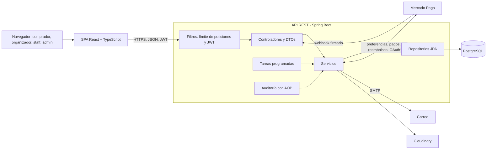

| Pieza | Demo online | En una PC |
|---|---|---|
| Frontend | Vercel | Vite, `localhost:5173` |
| Backend | Render, con Docker | Maven, `localhost:8080` |
| Base de datos | Neon | PostgreSQL |
| Correo | Brevo | MailHog |

[DOCUMENTADA: `docs/tecnica/DEPLOY_DEMO.md`, `README.md`]

### Las capas del backend

Un pedido baja por las capas y la respuesta sube.

| Capa | Paquete | Responsabilidad | No hace |
|---|---|---|---|
| Filtros | `security` | Frena abusos y reconoce al usuario por el token | Reglas de negocio |
| Controlador | `controllers` | Recibe el pedido, valida los datos, exige el rol | Consultar la base |
| Servicio | `services` | Reglas de negocio y transacciones | Saber de HTTP |
| Repositorio | `repositories` | Leer y escribir en la base | Decidir |
| Modelo | `models` | Entidades (tablas), enums y DTOs | — |

También están `config` (configuración y arranque) y `exceptions` (errores y su manejador global).

**Entidad y DTO:** la entidad es la fila de una tabla; el DTO es lo que entra o sale por la API. Se separan para no exponer campos internos (por ejemplo, el hash de la contraseña) ni atar la API a la base. [DOCUMENTADA: regla en `CLAUDE.md`]

### Un pedido real, capa por capa

Comprar entradas: `POST /tickets/comprar-online`.

**1. Ruta pública** (`security/SecurityConfig.java`): el comprador no inicia sesión.

```java
.requestMatchers(HttpMethod.POST, "/tickets/comprar-online").permitAll()
```

**2. Controlador** (`controllers/VentaController.java`): valida y delega.

```java
@PostMapping("/comprar-online")
public ResponseEntity<IniciarCompraResponseDTO> iniciarCompraOnline(
        @Valid @RequestBody CompraOnlineRequestDTO dto) {
    IniciarCompraResponseDTO response = ventaService.iniciarCompraOnline(dto);
    return ResponseEntity.status(HttpStatus.ACCEPTED).body(response);
}
```

**3. DTO** (`CompraOnlineRequestDTO.java`): las reglas de forma van acá.

```java
@Min(value = 1, message = "Tenés que comprar al menos 1 entrada")
@Max(value = 20, message = "No se pueden comprar más de 20 entradas por orden")
private Integer cantidad = 1;
```

**4. Servicio** (`services/VentaService.java`): valida en la base, pide el token de cobro, guarda la orden como `Pendiente` y recién ahí llama a Mercado Pago.

```java
DatosCompra datos = transacciones.execute(estado -> validarCompra(dto));
String tokenCobro = cuentaCobroService.tokenParaCobrar(datos.idOrganizador());
// ... arma la orden
TransaccionPago saved = transaccionPagoRepository.save(transaccion);
```

La llamada a Mercado Pago va **fuera de la transacción**: mientras se espera a un servicio externo no se retiene una conexión a la base. Si falla, la orden queda `Rechazada`.

**5. Error** (`exceptions/GlobalExceptionHandler.java`): cualquier falla vuelve como JSON con `status`, `error`, `path` y `timestamp`.

### Dos ideas que sostienen el diseño

**1. El servidor es la autoridad.** El frontend puede ocultar un botón, pero quien decide es el backend: rol, dueño del recurso, cupo y estado de la entrada. Cualquiera puede llamar a la API sin usar la pantalla.

**2. No se confía en lo que llega de afuera.** Cuando Mercado Pago avisa un pago, el backend vuelve a consultarlo a Mercado Pago antes de entregar entradas (`PagoWebhookService`). [DOCUMENTADA: `docs/tecnica/MERCADOPAGO_COBRO.md`]

### Concurrencia: no vender de más

Si dos personas compran la última entrada a la vez, solo una la recibe. Al confirmar el pago se bloquea la fila de la tanda y se descuenta solo si alcanza (`repositories/TandaRepository.java`):

```java
@Lock(LockModeType.PESSIMISTIC_WRITE)
@Query("SELECT t FROM Tanda t WHERE t.id = :id")
Optional<Tanda> findByIdWithLock(@Param("id") Long id);
```

```java
@Query("UPDATE Tanda t SET t.cupoDisponible = t.cupoDisponible - :cantidad " +
       "WHERE t.id = :id AND t.cupoDisponible >= :cantidad")
int decrementarCupo(@Param("id") Long id, @Param("cantidad") int cantidad);
```

**Bloqueo pesimista** = "trabo la fila mientras la uso; el resto espera". Se prueba en `VentaServiceConcurrencyTest`. Esto protege **la venta**; hay casos de concurrencia todavía sin proteger (editar una tanda mientras se vende y el saldo de créditos: ver sección 8).

### Trabajo que no dispara un usuario

| Tarea | Cada cuánto | Para qué |
|---|---|---|
| `VencimientoOrdenesJob` | 10 minutos | Antes de vencer una orden sin pagar, consulta a Mercado Pago |
| `RenovacionTokensMpJob` | 6 horas | Renueva los permisos de cobro de los organizadores |

La **auditoría** usa AOP (programación orientada a aspectos): se marca un método con `@Auditable` y se registra quién hizo qué, sin mezclar ese código con la regla de negocio (`security/audit`).

### Mapa de carpetas

```text
AsistiApp/
├─ backend/
│  ├─ src/main/java/com/asistiapp/backend/
│  │  ├─ controllers/   entrada HTTP (y controllers/admin)
│  │  ├─ services/      reglas de negocio (y services/admin)
│  │  ├─ repositories/  acceso a datos
│  │  ├─ models/        entities, dtos, enums
│  │  ├─ security/      JWT, roles, límite de peticiones, auditoría
│  │  ├─ config/        configuración y arranque
│  │  └─ exceptions/    errores y manejador global
│  ├─ src/main/resources/application.yml
│  ├─ src/test/         pruebas
│  ├─ db/migraciones/   cambios de base a mano
│  └─ Dockerfile
├─ frontend/
│  ├─ src/pages/        buyer, organizador, staff, admin, ayuda, legal
│  ├─ src/components/   piezas reutilizables (ui/ es el sistema de diseño)
│  ├─ src/lib/          api, sesión, tipos, formato
│  ├─ src/App.tsx       rutas
│  └─ e2e/              pruebas de punta a punta
├─ docs/                entrega, técnica y proyecto
├─ .github/workflows/   pruebas automáticas
└─ CLAUDE.md            reglas para el asistente de IA
```

Es un **monorepo**: backend y frontend en el mismo repositorio.

### Límites conocidos (díganlos antes de que se los marquen)

| Límite | Consecuencia | Salida |
|---|---|---|
| Una sola instancia del backend asumida: el límite de peticiones está en memoria | Con varias instancias cada una contaría aparte | Guardar el contador en un servicio compartido |
| Muchas relaciones son un número sin clave foránea (`id_organizador`, `id_evento` del staff) | La integridad la cuida el código | Agregar las claves foráneas |
| Tareas programadas dentro del mismo programa | Con varias instancias se ejecutarían repetidas | Coordinador o proceso aparte |
| Demo en plan gratuito | El backend se duerme y tarda 30–60 s en despertar | Plan pago |

[INFERIDA la consecuencia y la salida; los hechos se ven en el código y en `DEPLOY_DEMO.md`]

### Lo que tenés que saber

- Dibujar de memoria: navegador → React → API (filtros, controlador, servicio, repositorio) → PostgreSQL, con Mercado Pago, correo y Cloudinary al costado.
- Qué hace cada capa y qué **no** hace.
- Por qué el servidor es la autoridad.
- Cómo se evita la sobreventa.

### Repaso

**1. ¿Qué arquitectura tiene el sistema?**
Cliente-servidor: una SPA en React que consume una API REST sin estado; el backend es un monolito en capas sobre PostgreSQL.

**2. ¿Qué diferencia hay entre controlador, servicio y repositorio?**
El controlador traduce HTTP y valida la entrada; el servicio aplica las reglas y maneja la transacción; el repositorio accede a la base.

**3. ¿Para qué sirven los DTO?**
Para controlar qué entra y qué sale por la API sin exponer las entidades.

**4. Dos compran la última entrada a la vez: ¿qué pasa?**
Al confirmar cada pago se bloquea la fila de la tanda y se descuenta solo si queda cupo. El primero recibe la entrada; al segundo se le reembolsa.

**5. ¿Qué cambiarían si creciera mucho el tráfico?**
Antes de pensar en microservicios: sacar de memoria el límite de peticiones, coordinar las tareas programadas, correr varias instancias del backend y medir dónde está el cuello de botella.

---

## 4. Tecnologías ★

El porqué de cada elección y sus alternativas está en la sección 5. Acá: qué es, para qué y dónde.

### Backend

| Tecnología | Qué es | Para qué en AsistíAPP | Dónde |
|---|---|---|---|
| Java 17 | Lenguaje tipado | Todo el servidor | `backend/pom.xml` |
| Spring Boot 3.3.2 | Framework que arma la aplicación con configuración mínima | API, arranque, inyección de dependencias | `AsistiAppApplication` |
| Spring Web | Módulo HTTP | Controladores REST | `controllers/` |
| Spring Security | Autenticación y permisos | Rutas públicas y roles | `security/SecurityConfig` |
| Spring Data JPA / Hibernate | ORM: traduce objetos a tablas | Entidades y repositorios | `models/entities`, `repositories/` |
| Bean Validation | Reglas con anotaciones | Validar los DTO | `models/dtos` |
| Spring AOP | Agregar comportamiento alrededor de métodos | Auditoría | `security/audit` |
| jjwt 0.12.6 | Librería de JWT | Crear y verificar tokens (24 h) | `security/JwtUtils` |
| BCrypt | Hash de contraseñas, lento a propósito | No guardar contraseñas legibles | `SecurityConfig` |
| Bucket4j 8.14 | Límite de peticiones | Frenar abusos | `security/ratelimit` |
| ZXing 3.5.3 | Generador de QR | Imagen de la entrada | `services/QrImageService` |
| SDK de Mercado Pago 3.7 | Cliente oficial | Preferencias, pagos, reembolsos | `services/MercadoPagoService` |
| Spring Mail | Envío SMTP | Entradas, recuperación, avisos | `services/EmailService` |
| Cloudinary 2.5 | Almacenamiento de imágenes | Portadas y fotos de perfil | `services/ImagenService` |
| springdoc 2.6 | Documentación OpenAPI | Contrato de la API | `config/OpenApiConfig` |
| Lombok | Genera código repetitivo | Getters y constructores | Todo el backend |
| Maven | Gestión de dependencias y build | Compilar y probar | `pom.xml` |

### Base de datos

| Tecnología | Qué es | Detalle |
|---|---|---|
| PostgreSQL | Base relacional con transacciones | Datos del sistema |
| `ddl-auto: update` | Hibernate crea o amplía tablas al arrancar | No modifica restricciones: para eso están los scripts de `backend/db/migraciones` [DOCUMENTADA: `CLAUDE.md`] |

### Frontend

| Tecnología | Qué es | Para qué | Dónde |
|---|---|---|---|
| React 19 | Librería de interfaces por componentes | Todas las pantallas | `frontend/src` |
| TypeScript | JavaScript con tipos | Detectar errores antes de ejecutar | Todo el frontend |
| Vite | Servidor de desarrollo y empaquetador | `npm run dev` y `build` | `vite.config.ts` |
| Tailwind CSS 4 | Estilos con clases utilitarias | Diseño y responsive | `src/styles` |
| react-router 7 | Navegación en la SPA | Rutas por perfil | `App.tsx` |
| Recharts | Gráficos | Métricas | Paneles |
| html5-qrcode | Lectura de QR con la cámara | Escáner del staff | `pages/staff/ScannerPage.tsx` |
| Leaflet + OpenStreetMap | Mapas | Ubicación del evento | `components/EventMap.tsx` |
| ExcelJS | Genera planillas | Exportar entradas | Panel del organizador |
| lucide-react | Íconos | Interfaz | Componentes |
| sonner | Avisos emergentes | Confirmaciones y errores | Toda la app |

El cliente de la API es propio, sobre `fetch` (`lib/api.ts`): agrega el token y traduce los errores.

```ts
const token = getStoredToken();
if (token) {
  headers["Authorization"] = `Bearer ${token}`;
}
```

### Pruebas, automatización y despliegue

| Tecnología | Para qué |
|---|---|
| JUnit y Mockito | Pruebas del backend |
| H2 | Base en memoria para probar sin PostgreSQL |
| GreenMail | Servidor de correo falso para probar el envío |
| Vitest y Testing Library | Pruebas del frontend |
| Playwright | Pruebas de punta a punta en un navegador real |
| oxlint | Revisión de estilo y errores |
| Git y GitHub | Versiones y trabajo en equipo |
| GitHub Actions | Corre las pruebas en cada push y pedido de cambios a `master` |
| Docker | Empaqueta el backend para Render; MailHog en local |
| Vercel, Render, Neon, Brevo | Demo online |

### Lo planificado frente a lo usado

| PP2 (3.5) | Usado |
|---|---|
| React, Tailwind o Bootstrap | React con Tailwind |
| Java, Spring Boot | Igual |
| PostgreSQL | Igual |
| Spring Security, Spring Data JPA, JWT | Igual |
| SDK de Mercado Pago, html5-qrcode | Igual |
| Git, GitHub, Figma, Jira, Postman | Git y GitHub verificados; Figma usado en el diseño inicial; Jira no se usó; uso de Postman [A CONFIRMAR] |
| — | Sumados: ZXing, Cloudinary, Leaflet, Vitest, Playwright, Docker |

### Lo que tenés que saber

- Para cada tecnología principal, una frase: qué es y para qué se usa **acá**.
- Que ZXing **genera** el QR (servidor) y html5-qrcode lo **lee** (navegador).
- Que `ddl-auto: update` no reemplaza a una herramienta de migraciones.

### Repaso

**1. ¿Qué es un ORM y cuál usan?**
Una capa que relaciona objetos del código con tablas. Usan Hibernate a través de Spring Data JPA.

**2. ¿Con qué se genera y con qué se lee el QR?**
Se genera con ZXing en el backend y se lee con html5-qrcode en el navegador.

**3. ¿Para qué sirve TypeScript?**
Para detectar errores de tipos al escribir y compilar; además ayuda a mantener el contrato con la API (`npm run types:api`).

**4. ¿Cómo se guardan las contraseñas?**
Como hash BCrypt; no se pueden recuperar, solo comparar o restablecer.

**5. ¿Qué pasa cuando alguien hace push a `master`?**
GitHub Actions ejecuta las pruebas de backend y de frontend.

---

## 5. Decisiones de diseño ★

### Cómo responder "¿por qué eligieron esto y no lo otro?"

Una buena respuesta tiene cuatro partes:

1. **Qué** elegimos.
2. **Qué problema** resuelve en AsistíAPP.
3. **Qué otra opción** había y qué sacrificamos al no usarla.
4. **Cuándo** elegiríamos la otra.

Dos reglas:

- **No digan que compararon algo que no compararon.** "No lo evaluamos formalmente; hoy, mirándolo, la ventaja es…" es una respuesta válida y se nota honesta.
- **Si algo es flojo, díganlo ustedes primero**, con la mejora concreta.

En esta guía, "¿Se evaluó?" dice si hay registro de que el equipo comparó alternativas. Los motivos marcados [INFERIDA] **tienen que leerlos y aceptarlos** antes de usarlos.

### Mapa rápido

| # | Decisión | ¿Hay registro de la evaluación? | Punto flojo |
|---|---|---|---|
| 1 | Monolito en capas | No | — |
| 2 | SPA separada de la API | No | Posicionamiento en buscadores |
| 3 | Java y Spring Boot | No | — |
| 4 | PostgreSQL | No | Dinero guardado como `Double` |
| 5 | React, TypeScript, Vite, Tailwind | Parcial | — |
| 6 | Web en lugar de app móvil | Sí | Sin modo sin conexión |
| 7 | API REST | No | — |
| 8 | JWT sin estado | Parcial | Token en `localStorage` |
| 9 | Identificadores | No | — |
| 10 | QR de un solo uso | Sí | Sin conexión no se puede validar |
| 11 | Checkout Pro | Sí | — |
| 12 | Cuenta de cobro por organizador | Sí | No se prueba en sandbox |
| 13 | Créditos en lugar de comisión | Sí | Paga antes de vender |
| 14 | Compra sin cuenta y sin carrito | Parcial | Sin historial |
| 15 | Sin reserva de cupo | No | Se puede pagar y no recibir |
| 16 | Consulta periódica | Sí | Retraso de 20 s |
| 17 | `ddl-auto` y scripts | Sí | Frágil para producción |
| 18 | Monorepo, pruebas y CI | Parcial | — |
| 19 | Docker y servicios gratuitos | Sí | Arranque lento |
| 20 | Scrum planificado, fases en la práctica | Sí | Lo hecho difiere de lo planificado |

---

### 5.1 Arquitectura monolítica en capas

**Elegido:** un solo backend dividido en controladores, servicios y repositorios (`backend/src/main/java/com/asistiapp/backend`).

**Problema que resuelve:** ordenar el código para que cuatro personas lo entiendan y para que las reglas de negocio queden en un solo lugar.

| Opción | A favor, en AsistíAPP | En contra, en AsistíAPP |
|---|---|---|
| **Monolito en capas** | Una compra toca tanda, orden, entrada y créditos en una sola transacción; un solo despliegue | Todo escala junto; si cae, cae todo |
| Microservicios | Escalar solo la venta en un evento masivo | Transacciones repartidas entre servicios, varios despliegues y mucho trabajo de infraestructura para cuatro personas |
| Arquitectura hexagonal | Aísla las reglas de Spring y de Mercado Pago | Más interfaces y archivos para el mismo resultado |
| Servicios en la nube sin backend propio | Menos código | Las reglas de cupo y pago quedarían fuera de control |

**Se sacrifica:** escalar partes por separado.
**Cuándo convendría otra:** con muchos eventos masivos simultáneos y equipos separados por área.
**30 segundos:** "Usamos un monolito en capas porque vender una entrada necesita que cupo, pago y entrada cambien juntos, y eso en una sola base y un solo programa es una transacción. Para nuestro tamaño, microservicios agregaban complejidad sin resolver un problema que tuviéramos."
**Evidencia:** la elección está en el PP2 (3.2) [DOCUMENTADA]; la comparación [INFERIDA].

### 5.2 SPA separada de la API

**Elegido:** React en `frontend/` que consume la API por HTTP; se despliegan por separado.

**Problema que resuelve:** pantallas rápidas e interactivas (escáner, punto de venta, paneles) y un backend que sirva a cualquier cliente.

| Opción | A favor | En contra |
|---|---|---|
| **SPA + API** | Se trabaja en paralelo; el rediseño del frontend no tocó la lógica del servidor; una app móvil usaría la misma API | Hay que configurar CORS y mantener el contrato entre ambos |
| Páginas generadas en el servidor (Thymeleaf) | Un solo proyecto | Escáner y paneles quedarían más pobres |
| React con renderizado en servidor (Next.js) | Mejor posicionamiento y vista previa al compartir un evento | Otra pieza de servidor que aprender y desplegar |

**Se sacrifica:** posicionamiento en buscadores y vistas previas ricas de cada evento.
**Mitigación del contrato:** una prueba (`OpenApiContratoTest`) falla si cambia la API y no se actualiza la copia del frontend. [DOCUMENTADA: `CLAUDE.md`]
**Cuándo convendría otra:** si atraer público desde buscadores fuera central.
**30 segundos:** "Separamos interfaz y servidor para trabajarlos en paralelo y porque el escáner y el punto de venta son muy interactivos. El costo es el posicionamiento en buscadores; si fuera prioritario, evaluaríamos renderizado en servidor."
**Evidencia:** PP2 4.4 [DOCUMENTADA]; comparación [INFERIDA].

### 5.3 Java y Spring Boot

**Elegido:** Java 17 con Spring Boot 3.3.2 (`pom.xml`).

**Problema que resuelve:** seguridad, transacciones y acceso a datos ya resueltos y probados.

| Opción | A favor | En contra |
|---|---|---|
| **Spring Boot** | `@Transactional`, bloqueos, Spring Security y SDK oficial de Mercado Pago | Arranca más lento y usa más memoria: se nota en el plan gratuito (tope de 380 MB en el `Dockerfile`) |
| Node.js (Express o NestJS) | Un solo lenguaje con el frontend | Seguridad y transacciones se arman con más piezas |
| Python (Django) | Muy rápido para empezar | El equipo tendría que dominar otro ecosistema |
| .NET | Equivalente en capacidades | Sin ventaja clara para el equipo |

**Se sacrifica:** consumo de recursos y compartir lenguaje con el frontend.
**30 segundos:** "El PP2 fijó Java con Spring Boot por tipado fuerte y manejo seguro de peticiones concurrentes. En la práctica nos dio transacciones y seguridad listas, que es lo más delicado de vender entradas. El costo es que es pesado para un hosting gratuito."
**Evidencia:** PP2 3.5 [DOCUMENTADA]. Que la formación del equipo en Java haya pesado: [A CONFIRMAR].

### 5.4 PostgreSQL

**Elegido:** PostgreSQL con JPA; H2 solo en pruebas.

**Problema que resuelve:** no vender de más y no perder consistencia entre dinero y entradas.

| Opción | A favor | En contra |
|---|---|---|
| **PostgreSQL** | Transacciones ACID, bloqueo de filas, gratuito, disponible en la nube | Hay que diseñar el esquema |
| MySQL / MariaDB | Equivalente para este caso | Sin ventaja concreta |
| MongoDB | Esquema flexible | Los datos son relacionales (evento, tanda, entrada) y se necesitan transacciones entre ellos |
| Firebase | Tiempo real incluido | Reglas de cupo y pago más difíciles de controlar y dependencia del proveedor |

**ACID:** atomicidad (todo o nada), consistencia, aislamiento (las operaciones simultáneas no se pisan) y durabilidad (lo confirmado no se pierde).

**Se sacrifica:** flexibilidad de esquema.
**Puntos flojos:** (1) los precios y montos son `Double`; para dinero corresponde `BigDecimal` y columnas `NUMERIC`. Los cálculos con Mercado Pago se hacen en `BigDecimal`, pero se guardan como `Double`. (2) Varias relaciones son un número sin clave foránea. (3) Las pruebas usan H2, que no se comporta idéntico a PostgreSQL.
**30 segundos:** "Elegimos PostgreSQL porque necesitábamos transacciones y bloqueo de filas para no sobrevender. Una base documental no nos daba ventaja: los datos son relacionales. Lo que mejoraríamos es guardar el dinero como decimal exacto."
**Evidencia:** PP2 3.5 [DOCUMENTADA]; puntos flojos verificados en el código.

### 5.5 React, TypeScript, Vite y Tailwind

**Elegido:** React 19 + TypeScript + Vite + Tailwind CSS 4.

**Problema que resuelve:** interfaces por componentes, errores detectados antes de ejecutar y un diseño consistente y responsive.

| Opción | A favor | En contra |
|---|---|---|
| **React** | Ecosistema grande; el prototipo inicial de Figma Make ya era React | Es una librería: hay que elegir las demás piezas |
| Angular | Todo incluido y con reglas fijas | Curva más larga |
| Vue | Simple | Sin ventaja concreta aquí |
| **Tailwind** | Estilos junto al componente; tokens de color para claro y oscuro | Clases largas en el HTML |
| Bootstrap (mencionado en el PP2) | Componentes listos | Se ve genérico y cuesta darle identidad |
| **TypeScript** | Avisa si un cambio de la API rompe una pantalla | Más código de tipos |
| **Vite** | Arranque y compilación rápidos | — |

**Se sacrifica:** la estructura impuesta que daría un framework completo.
**30 segundos:** "React porque la interfaz se arma con piezas reutilizables y ya veníamos de un prototipo en React; TypeScript para atrapar errores del contrato con la API; Tailwind para sostener un sistema de diseño con modo claro y oscuro."
**Evidencia:** React y "Tailwind o Bootstrap" en PP2 3.5; origen en Figma Make en `frontend_implementation_plan.md` [DOCUMENTADA]. El resto [INFERIDA].

### 5.6 Web responsive en lugar de aplicación móvil

**Elegido:** una web que se adapta al tamaño de pantalla, incluso para el escáner (`html5-qrcode`).

**Problema que resuelve:** que comprador y staff usen el sistema sin instalar nada.

| Opción | A favor | En contra |
|---|---|---|
| **Web responsive** | Un solo código; se entra por un enlace; el staff usa su propio celular | La cámara depende del navegador y exige HTTPS; no funciona sin conexión |
| App nativa (Android e iOS) | Mejor cámara y modo sin conexión | Dos desarrollos y publicación en tiendas |
| App multiplataforma (Flutter, React Native) | Un código para dos sistemas | Sigue requiriendo instalación y tiendas |
| Web instalable (PWA) | Ícono y algo de uso sin conexión | Trabajo extra no previsto |

**Se sacrifica:** validar entradas sin internet.
**Cuándo convendría otra:** eventos en lugares con mala señal: ahí hace falta una validación sin conexión con sincronización.
**30 segundos:** "Buscábamos cero fricción: el comprador entra por un enlace y el staff escanea desde el navegador. El límite es que sin internet no se puede validar."
**Evidencia:** objetivo del PP2 ("sin necesidad de instalar una aplicación nativa") y 3.5 [DOCUMENTADA].

### 5.7 API REST

**Elegido:** recursos por HTTP con JSON, documentados con OpenAPI (springdoc).

| Opción | A favor | En contra |
|---|---|---|
| **REST** | Simple, usa los códigos y métodos de HTTP, fácil de probar; es lo que usa el webhook | Algunas pantallas piden varias llamadas o reciben datos de más |
| GraphQL | El cliente pide justo lo que necesita | Más complejidad en seguridad y caché; un solo cliente propio no lo justifica |
| gRPC | Muy eficiente entre servidores | Incómodo desde el navegador |

**Detalle honesto:** hay rutas con verbo (`/tickets/validate`, `/eventos/{id}/publicar`). Son acciones de negocio; un REST estricto las modelaría como cambios de estado.
**30 segundos:** "REST porque el sistema es de recursos y acciones simples, con un único cliente. GraphQL resolvía un problema que no teníamos."
**Evidencia:** PP2 3.2 [DOCUMENTADA]; comparación [INFERIDA].

### 5.8 JWT sin estado, con el token en `localStorage`

**Elegido:** al iniciar sesión el backend firma un token (HMAC-SHA256, 24 h) con correo, rol e id (`JwtUtils`). El navegador lo guarda en `localStorage` y lo manda en `Authorization: Bearer`.

**Analogía:** una pulsera de festival firmada: el portero verifica la firma sin llamar a la boletería.

| Opción | A favor | En contra |
|---|---|---|
| **JWT en `localStorage`** | El servidor no guarda sesiones; simple entre dominios distintos (Vercel y Render); sin riesgo de CSRF | Un XSS podría leer el token; cerrar sesión no lo invalida en el servidor |
| JWT en cookie `HttpOnly` | JavaScript no puede leerlo | Hay que proteger contra CSRF; más difícil entre dominios distintos |
| Sesiones en el servidor | Se pueden cortar al instante | Hay que guardar y compartir sesiones |
| Token corto + token de renovación | Limita el daño de un robo | Más lógica |

**Lo que lo mejora (importante):** en cada pedido se vuelve a buscar al usuario y se rechaza si está suspendido:

```java
UserDetails userDetails = userDetailsService.loadUserByUsername(userEmail);
if (userDetails.isEnabled() && jwtUtils.isTokenValid(jwt, userDetails)) {
```

Por eso no es "sin estado" puro: hay una consulta por pedido, a cambio de poder cortar el acceso. [DOCUMENTADA: commit "una cuenta suspendida deja de poder entrar, ni con sesion abierta"]

**Se sacrifica:** revocar un token puntual y protección ante XSS.
**30 segundos:** "JWT porque la API no guarda sesiones y el frontend está en otro dominio. Lo guardamos en `localStorage`, que evita CSRF pero expone el token si hubiera XSS; con dominio propio lo pasaríamos a una cookie HttpOnly. Y si suspendemos una cuenta, deja de entrar en el acto."
**Evidencia:** PP2 y `SECURITY.md` (que registra el costo y la mejora) [DOCUMENTADA].

### 5.9 Identificadores

**Elegido:** tres tipos distintos según quién los ve.

| Identificador | Forma | Para qué | Quién lo ve |
|---|---|---|---|
| Clave primaria | `Long` autoincremental | Relacionar tablas | Se ve en la API (por ejemplo, la tanda al comprar) |
| `codigoQr` | `QR-` + 32 caracteres hexadecimales de un UUID al azar | Ser la entrada | Quien compró |
| `externalReference` | UUID | Identificar la orden ante Mercado Pago | Comprador y Mercado Pago |
| `urlPublica` | Nombre del evento + 8 caracteres al azar | Enlace legible | Público |

```java
codigoQr = "QR-" + UUID.randomUUID().toString().replace("-", "").toUpperCase();
```

| Opción | A favor | En contra |
|---|---|---|
| **Mixto** | Claves chicas y rápidas adentro; valores imposibles de adivinar afuera | Hay que tener claro cuál usar |
| UUID en todo | Nada es adivinable | Índices más grandes y más difícil de depurar |
| Número secuencial en el QR | Corto | Se podría probar números y entrar con la entrada de otro |

**Por qué los `Long` no son un agujero:** conocer un id no alcanza; cada operación verifica el dueño (protección contra **IDOR**: acceder a un recurso ajeno cambiando el id). Un IDOR real en la venta manual se encontró y corrigió. [DOCUMENTADA: `frontend_implementation_plan.md`, Fase 4]

**30 segundos:** "Adentro usamos números porque son eficientes; hacia afuera, valores al azar imposibles de adivinar. Y además cada pedido verifica que el recurso sea de quien lo pide."
**Evidencia:** código [DOCUMENTADA]; motivo [INFERIDA].

### 5.10 QR de un solo uso validado en el servidor

**Elegido:** el QR contiene solo el código. El backend busca la entrada y decide según su estado (`StaffQRService.validarQR`).

Se rechaza si: no existe, es de otro evento, está `Anulada`, ya está `Usada`, o el evento está cancelado o finalizado. Si pasa, queda `Usada` con fecha y quién la validó.

| Opción | A favor | En contra |
|---|---|---|
| **Código al azar + consulta al servidor** | No se puede inventar; una copia sirve una sola vez; se puede anular | Requiere internet |
| QR firmado que se verifica sin conexión | Funciona sin señal | No sabe si otra puerta ya lo usó, salvo que sincronicen |
| QR que cambia cada pocos segundos | Una captura vence | Exige app o página abierta |

**Se sacrifica:** funcionar sin conexión.

**Dos escaneos al mismo tiempo.** No alcanza con leer la entrada y después guardarla: dos puertas podrían leerla "sin usar" a la vez. Por eso comprobar y marcar es **una sola orden** a la base:

```java
UPDATE Entrada e SET e.estado = Usada, e.fechaUso = :fechaUso, ...
WHERE e.id = :id AND e.estado = Pagada     // 1 fila: entra · 0 filas: rechazada
```

Es como la última silla en el juego de las sillas: la base atiende de a uno y solo el primero la encuentra libre.

**La historia (sirve para contarla):** hasta el 27/11 se leía y después se guardaba. Lo detectamos revisando el código, escribimos una prueba con 8 validaciones simultáneas del mismo QR y **las 8 daban válida**; con el cambio entra una sola. (`StaffQRConcurrencyTest`, `EntradaRepository.marcarComoUsada`)

**⚠️ Lo que queda:** si el organizador anula o reembolsa una entrada en el mismo instante en que se escanea, la anulación puede pisar el ingreso registrado (leído en el código, sin reproducir). No permite entrar dos veces.

**30 segundos:** "El QR no tiene datos, solo un código al azar; quien decide es el servidor, así una captura sirve para un solo ingreso. Necesita conexión."
**Evidencia:** objetivo del PP2 (un solo uso con validación en tiempo real) [DOCUMENTADA]; código.

### 5.11 Mercado Pago Checkout Pro

**Elegido:** el backend crea una "preferencia", el comprador paga en la página de Mercado Pago y el resultado llega por webhook.

| Opción | A favor | En contra |
|---|---|---|
| **Checkout Pro** | El sistema nunca toca datos de tarjetas; implementación corta; coincidía con la simulación que ya existía | El comprador sale del sitio |
| Checkout API / Payment Brick | Pago sin salir del sitio | Más complejidad y responsabilidad sobre datos de pago |
| Otras pasarelas | Alternativa | Menor adopción local |
| Transferencia manual | Sin pasarela | Vuelve el problema que se quería resolver |

**Tres defensas:** firma del webhook, nueva consulta del pago a Mercado Pago e idempotencia (**idempotente**: recibir el mismo aviso varias veces produce un solo resultado).
**Se sacrifica:** control de la experiencia de pago.
**30 segundos:** "Elegimos Checkout Pro porque Mercado Pago es lo que la gente usa acá y porque así no manejamos tarjetas. Comparamos con el checkout integrado: era más complejo y nos sumaba responsabilidad."
**Evidencia:** `docs/tecnica/Propuesta_Integracion_MercadoPago.docx` [DOCUMENTADA]. La comparación con otras pasarelas: [A CONFIRMAR].

### 5.12 Cuenta de cobro propia de cada organizador

**Elegido:** cada organizador vincula su cuenta de Mercado Pago con **OAuth** (autoriza a la aplicación sin darle su contraseña); el dinero de sus entradas cae en su cuenta. Los tokens se guardan cifrados con AES-256-GCM (`TokenCifradoService`).

| Opción | A favor | En contra |
|---|---|---|
| **Cuenta de cada organizador** | La plataforma no tiene dinero ajeno ni liquida pagos | Vinculación, renovación y revocación de tokens; más difícil de probar |
| Todo a la cuenta de la plataforma | Simple | Habría que repartir el dinero y asumir responsabilidad legal y fiscal |
| Pago dividido con comisión (`marketplace_fee`) | La plataforma cobra por venta | Contradice el modelo sin comisión |

**Limitación para la demo:** el cobro con la cuenta vinculada no se pudo probar con usuarios de prueba; se probó con **dinero real** el 17/11. La demo online cobra con la cuenta de la plataforma (`MP_EXIGIR_CUENTA_VINCULADA=false`). Díganlo así. [DOCUMENTADA: `MERCADOPAGO_COBRO.md`, `DEPLOY_DEMO.md`]
**30 segundos:** "El dinero de las entradas nunca pasa por nosotros: cada organizador conecta su cuenta y cobra directo. Nos evita custodiar plata ajena, a cambio de manejar sus permisos con cuidado."
**Evidencia:** `MODELO_DE_COBRO.md`, decisiones del 17/11 [DOCUMENTADA].

### 5.13 Créditos en lugar de comisión

**Elegido:** el organizador compra paquetes de créditos. **1 crédito = 1 entrada** (se descuentan al crear cada tanda) y publicar tiene un costo configurable. La plataforma no cobra comisión sobre las ventas.

| Opción | A favor | En contra |
|---|---|---|
| **Créditos** | Costo conocido de antemano; ingreso de la plataforma separado del dinero de las entradas | El organizador paga antes de vender |
| Comisión por venta | Sin costo inicial | Es lo que cobran las plataformas grandes y obliga a intervenir en cada pago |
| Suscripción mensual | Ingreso estable | No conviene a quien organiza pocos eventos |

**No confundir:** Mercado Pago sí cobra su comisión. El organizador elige absorberla o trasladarla al comprador como cargo por procesamiento; ese cargo **no va a la plataforma**. [DOCUMENTADA: decisión del 17/11]
**Devoluciones de créditos:** al cancelar vuelven los de las entradas sin vender; una anulada devuelve su crédito una sola vez.
**30 segundos:** "Cobramos créditos en vez de un porcentaje: el organizador sabe cuánto le cuesta antes de vender y su recaudación es toda suya."
**Evidencia:** PP2 (fundamentación) y `MODELO_DE_COBRO.md` [DOCUMENTADA].

### 5.14 Compra sin cuenta y sin carrito

**Elegido:** se elige una tanda y una cantidad (hasta 20), se cargan nombre y correo y se paga. La entrada llega por correo.

| Opción | A favor | En contra |
|---|---|---|
| **Sin cuenta** | Menos pasos; no se guardan contraseñas de compradores | No hay historial; si el correo está mal, cuesta recuperar la entrada (por eso se pide confirmarlo) |
| Con cuenta | Historial y recuperación | Fricción, justo uno de los problemas detectados |
| **Compra directa** | Simple y una orden clara | No se mezclan tandas ni eventos en un pago |
| Carrito | Varias tandas juntas | Más estados, y cada evento cobra en una cuenta distinta |

**Sobre el carrito:** la planilla Scrum lo nombra, pero no existe. Preséntenlo como compra directa. El motivo (cada organizador cobra en su cuenta y un carrito mezclaría cobros) es [INFERIDA]: acéptenlo o cámbienlo.
**30 segundos:** "El comprador no se registra porque cada paso de más es una venta perdida. Compra una tanda y paga; un carrito mezclaría eventos de organizadores que cobran en cuentas distintas."
**Evidencia:** sin cuenta: PP2 y decisión del 22/10 [DOCUMENTADA]. Sin carrito [INFERIDA].

### 5.15 Sin reserva de cupo

**Elegido:** al iniciar la compra no se descuenta cupo. Se descuenta cuando el pago se confirma, con la fila de la tanda bloqueada. Si ya no hay, se reembolsa automáticamente.

| Opción | A favor | En contra |
|---|---|---|
| **Descontar al confirmar** | Nadie bloquea entradas sin pagar; sin tareas para liberar reservas | Alguien puede pagar y no recibir la entrada |
| Reservar unos minutos | Quien está pagando tiene su lugar asegurado | Hay que liberar reservas vencidas y se puede abusar reservando sin pagar |

**Se sacrifica:** experiencia del comprador en las últimas entradas.
**Cuándo convendría otra:** en eventos con alta demanda, reservar unos minutos es mejor. Es la mejora a mencionar.
**30 segundos:** "Nunca sobrevendemos: el cupo se descuenta con la fila bloqueada al confirmar el pago. El costo es que en las últimas entradas alguien puede pagar y recibir el reembolso; con más demanda agregaríamos reserva temporal."
**Evidencia:** código y `PLANIFICADO_VS_CONSTRUIDO.md` [DOCUMENTADA]; motivo [A CONFIRMAR].

### 5.16 Consulta periódica en lugar de WebSockets

**Elegido:** el panel vuelve a pedir las métricas cada 20 segundos mientras la pestaña está visible.

```ts
const intervalo = setInterval(() => { /* vuelve a pedir las métricas */ }, 20000);
```

| Opción | A favor | En contra |
|---|---|---|
| **Consulta periódica** | Muy simple; no cambió la arquitectura | Hasta 20 s de retraso y pedidos aunque no haya novedades |
| WebSockets | Instantáneo | Conexiones abiertas, reconexión y más infraestructura |
| Eventos del servidor (SSE) | Instantáneo en un sentido | También conexiones abiertas |

**Se sacrifica:** tiempo real estricto; además no hay indicador de desconexión (CU-012 lo pedía).
**30 segundos:** "Para mirar ventas, 20 segundos de demora no cambian ninguna decisión; WebSockets agregaba complejidad sin beneficio real."
**Evidencia:** decisión del 22/10: "alcanza con polling" [DOCUMENTADA].

### 5.17 Esquema con `ddl-auto: update` y scripts manuales

**Elegido:** Hibernate crea y amplía tablas; los cambios que no hace (restricciones) van en 14 scripts de `backend/db/migraciones`.

| Opción | A favor | En contra |
|---|---|---|
| **`ddl-auto` + scripts** | Rápido mientras el modelo cambia | Hay que acordarse de correr cada script; no queda registro de cuáles se aplicaron |
| Flyway o Liquibase | Cambios versionados, aplicados solos y en orden | Más disciplina y trabajo inicial |

**Es una decisión floja para producción** y el equipo lo tiene anotado: Flyway quedó en pausa porque no se iba a desplegar (16/11). [DOCUMENTADA: `DECISIONES.md`, `PLAN_MEJORAS.md` 4.1]
**30 segundos:** "En desarrollo nos permitió avanzar rápido; para producción no alcanza y el siguiente paso es Flyway."

### 5.18 Monorepo, pruebas e integración continua

**Elegido:** un repositorio con backend y frontend; pruebas en ambos y GitHub Actions en cada push y pedido de cambios a `master`.

| Opción | A favor | En contra |
|---|---|---|
| **Monorepo** | Un cambio de API y su pantalla van juntos; la IA ve todo el proyecto | Crece todo en un lugar |
| Dos repositorios | Permisos y ritmos separados | Coordinar versiones |

**Pruebas:** 610 del backend (27/11), 449 del frontend y 4 de punta a punta (26–27/11). Los números cambian: verifíquenlos antes de la defensa.
**Se sacrifica:** las pruebas de punta a punta no corren en GitHub; se ejecutan a mano. El pago real no está automatizado.
**30 segundos:** "Un solo repositorio para que cada cambio quede completo, y pruebas automáticas para que lo que ya andaba no se rompa, algo clave trabajando con IA."
**Evidencia:** monorepo en `frontend_implementation_plan.md`; flujos en `.github/workflows` [DOCUMENTADA]; motivo [INFERIDA].

### 5.19 Contenedores y despliegue en servicios gratuitos

**Elegido:** `Dockerfile` de dos etapas para el backend (compila y luego corre solo el `.jar`, con un usuario sin privilegios); demo en Vercel, Render, Neon y Brevo. En local, Docker solo para MailHog.

| Opción | A favor | En contra |
|---|---|---|
| **Servicios gratuitos** | Sin costo; cada pieza en un lugar especializado | El backend se duerme (30–60 s); límites; Render bloquea puertos de correo (por eso Brevo) |
| Servidor propio con docker compose | Control total | Hay que administrarlo y pagarlo |
| Plan pago | Sin arranque lento | Costo |

**30 segundos:** "El objetivo era mostrar el sistema funcionando sin costo. Para producción pasaríamos a un plan pago, con dominio propio."
**Evidencia:** `DEPLOY_DEMO.md` [DOCUMENTADA]; al principio la decisión fue no desplegar (16/11) y se reabrió el 20/11 [DOCUMENTADA: `DECISIONES.md`, commit del Dockerfile].

### 5.20 Metodología

**Elegido:** Scrum en la planificación; en el desarrollo, fases con plan escrito, verificación y aprobación antes de seguir.

| Opción | A favor | En contra |
|---|---|---|
| **Fases con plan** | Encaja con el trabajo asistido por IA: instrucciones acotadas y revisables | Menos ceremonias y métricas del equipo |
| Scrum completo | Seguimiento y estimación | Requiere constancia en reuniones y tablero |
| Cascada | Todo definido antes | Rígido ante cambios, que hubo muchos |

**Se sacrifica:** medir velocidad y comparar contra la estimación del PP2.
**30 segundos:** "Planificamos con Scrum, pero al desarrollar nos resultó mejor trabajar por fases cortas en reuniones conjuntas: planificar, implementar, probar y recién avanzar."
**Evidencia:** PP2, `CLAUDE.md` y respuesta del equipo [DOCUMENTADA].

### Lo que tenés que saber

- La estructura de respuesta: qué, para qué, qué otra opción, cuándo la otra.
- Los puntos flojos y su mejora: token en `localStorage`, dinero como `Double`, migraciones manuales, sin reserva de cupo.
- Cuáles comparaciones se hicieron de verdad: sobre todo Checkout Pro y el modelo de cobro.

### Repaso

**1. ¿Por qué no microservicios?**
Porque vender una entrada necesita cambiar cupo, orden y entrada en una transacción, y para cuatro personas los microservicios agregaban complejidad sin un problema que la justificara.

**2. ¿Qué harían distinto si empezaran de nuevo?**
Dinero como decimal exacto, migraciones con Flyway desde el principio, claves foráneas en todas las relaciones y probar desde el principio qué pasa cuando dos personas hacen lo mismo a la vez.

**3. ¿JWT no tiene el problema de que no se puede revocar?**
Un token puntual no. Pero en cada pedido se consulta al usuario, así que una cuenta suspendida deja de entrar de inmediato.

**4. ¿Qué pasa con los datos de la tarjeta?**
No pasan por AsistíAPP: se cargan en la página de Mercado Pago.

**5. ¿Evaluaron todas estas alternativas?**
No todas de forma formal. Las documentadas son el tipo de integración de pagos, el modelo de cobro, el tiempo real y las migraciones; en el resto partimos del stack definido en el PP2.

---

## 6. Uso de inteligencia artificial ★

### La respuesta corta

"Usamos IA con permiso de la cátedra, para escribir buena parte del código y la documentación a partir de nuestras especificaciones. Nosotros definimos qué construir y con qué reglas, aprobamos cada plan, probamos y corregimos. Somos responsables de todo lo entregado."

Ajusten "buena parte" a lo que los cuatro consideren cierto. [A CONFIRMAR] **No den porcentajes**: no hay forma de medirlos.

### Palabras que conviene usar bien

| Término | Qué es |
|---|---|
| **Modelo** | El sistema de IA que genera texto y código |
| **Agente** | La herramienta que usa el modelo para además leer archivos, ejecutar comandos y modificar el proyecto, con permiso |
| **Prompt** | La instrucción que se le da |
| **Contexto** | Lo que la IA tiene a la vista: archivos, reglas, historial. No recuerda lo que no está ahí |
| **Alucinación** | Que invente algo que suena correcto y no lo es |

### Herramientas

| Herramienta | Uso | Evidencia |
|---|---|---|
| Claude Code, dentro de Visual Studio Code | Desarrollo de backend y frontend, pruebas, documentación, despliegue | Equipo; historial local desde el 16/08 [DOCUMENTADA] |
| Google Antigravity | Desarrollo, entre otras cosas fases iniciales del backend | Equipo; registro del 13–14/08 con el plan de la fase 3 [DOCUMENTADA] |
| Figma Make | Prototipo visual inicial | `frontend_implementation_plan.md` [DOCUMENTADA] |
| Stitch | Una propuesta de diseño posterior, ya reemplazada | `DECISIONES.md` 17/11 menciona el prototipo "TicketVibe"; que fuera de Stitch: [A CONFIRMAR] |
| Claude Design | Último rediseño | [A CONFIRMAR] |

La mayoría usó las mismas herramientas, casi siempre desde la cuenta de Felipe. [DOCUMENTADA: respuesta del equipo]

### Documentos de instrucciones por especialidad (los "agentes")

La IA no conoce el proyecto de antemano. Le escribimos documentos que lee según la tarea; `CLAUDE.md` es el índice que le dice cuál leer.

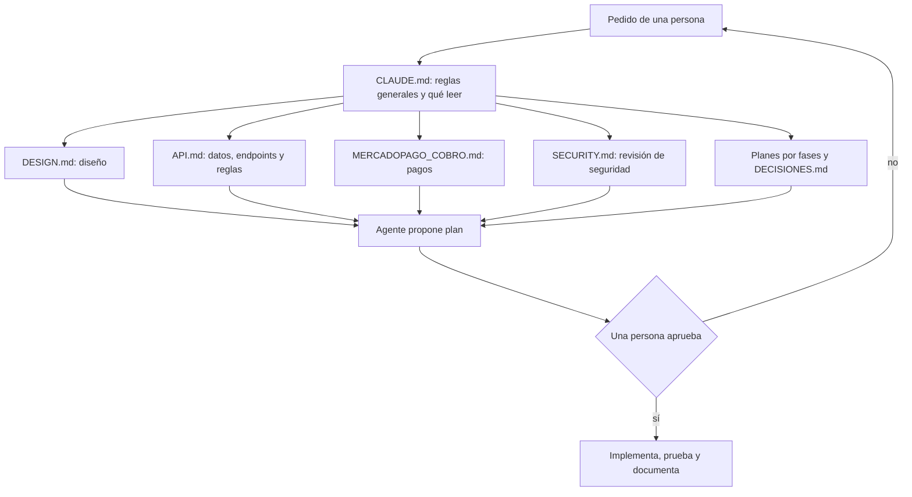

| Documento | "Especialidad" | Ejemplo de regla |
|---|---|---|
| `CLAUDE.md` | General | No avanzar de fase sin confirmación; verificar en un navegador real |
| `docs/tecnica/DESIGN.md` | Diseño | Colores y componentes: "no inventes clases de Tailwind" |
| `docs/tecnica/API.md` | Backend y datos | Modelo, endpoints y reglas de negocio |
| `docs/tecnica/MERCADOPAGO_COBRO.md` | Pagos | Cada llamada lleva su token; nunca imprimirlo |
| `docs/tecnica/SECURITY.md` | Seguridad | Auditar inyección SQL, XSS, CSRF e IDOR |

**Precisión importante:** en el repositorio son **documentos de contexto especializados**, no programas autónomos que trabajen solos ni que se coordinen entre sí. Si los llaman "agentes", expliquen eso en la misma frase. Si algún integrante configuró agentes aparte en su herramienta, muéstrenlo. [A CONFIRMAR]

`CLAUDE.md` existe desde el 14/08 y se fue ampliando con lo que se aprendía (por ejemplo, las trampas de Mercado Pago). [DOCUMENTADA: historial de Git]

### Documentos para no perder el hilo

| Documento | Para qué |
|---|---|
| `backend_implementation_plan.md` y `frontend_implementation_plan.md` | Qué está hecho, qué falta y por qué se adaptó cada fase |
| `docs/proyecto/DECISIONES.md` | Decisiones con fecha, preguntas abiertas y deuda técnica |
| `docs/proyecto/CONTINUAR.md` | Retomar en otra PC o con otro agente sin volver a investigar |
| `docs/proyecto/INTEGRAR_AUDITORIA.md` | Instrucciones para integrar el trabajo de un compañero |

### Cómo se daban las instrucciones

El equipo aprendió que **había que ser exacto y específico**: lo que no se detallaba, la IA a veces lo inventaba. [DOCUMENTADA: respuesta del equipo]

| Técnica | Cita real |
|---|---|
| Dar contexto antes de pedir | "en la carpeta docs esta toda la informacion del proyecto (…) en el claude.md las reglas que debe seguir el agente" (13/08) |
| Pedir el plan antes del código | "como crees que deberiamos organizarlos y que prioridad le damos a cada uno. no hagas nada todavia" (06/10) |
| Definir la regla y verificar que se entendió | "te la digo con mis palabras a ver si la entendiste, la idea seria que un organizador se registra y compra un pack de creditos (…)" (17/11) |
| Proponer la solución | "la solucion que yo pense fue que el checkout de mercado pago se abra en una pestania diferente (…)" (10/11) |
| Describir lo que pasa y lo que debería pasar | "hay eventos cargados que ya pasaron su fecha (…) y siguen mostrandose disponibles (…) no tendria que ser posible" (22/10) |
| Fijar el proceso | "cualquier error que vayas encontrando (…) agregandolos a los planes de implementaciones y resolvelos" (06/10) |

Más ejemplos en `entrega-demo/ejemplos-ia.md`.

### Quién decidía

| Decidieron las personas | Hizo la IA |
|---|---|
| Qué problema resolver y qué construir | Proponer planes y opciones |
| Modelo de cobro (créditos y cuenta propia) | Implementarlo |
| Que la plataforma no intervenga en reembolsos | Construir el botón que deriva al organizador |
| Aprobar cada fase, commit y despliegue | Escribir código, pruebas y documentación |
| Probar a mano y con dinero real | Probar en navegador automatizado |

### Errores de la IA y cómo se corrigieron

| Error | Cómo se detectó | Qué enseña |
|---|---|---|
| El código llamaba a Mercado Pago dentro de una transacción, contra la regla escrita del proyecto | Revisión del código contra las reglas (27/11) | Tener la regla escrita no garantiza que se cumpla: hay que verificar |
| Informó "27 de 28 casos de uso implementados" mirando solo que existieran | Comparación paso a paso: 17 coinciden, 10 con diferencias, 1 falta | No aceptar el primer resumen: pedir evidencia |
| El nombre de usuario no quedaba fijo; la causa era una animación que rompía `position: fixed` | Prueba manual (07/10) | Que compile no significa que se vea bien |

[DOCUMENTADA: historial local, `DECISIONES.md`, commits]

### Cómo se verificaba lo que producía

1. Plan escrito y aprobado antes de programar.
2. Pruebas automáticas (610 backend, 449 frontend, 4 de punta a punta) y GitHub Actions.
3. Prueba contra el backend real, con capturas en celular y computadora. [DOCUMENTADA: `CLAUDE.md`]
4. Prueba manual de las personas, incluido un pago con dinero real.
5. Confirmación humana antes de cada commit y despliegue.

**Límite:** muchas pruebas también las escribió la IA. Una prueba puede pasar y no cubrir el caso que importa (pasó con el escaneo simultáneo del QR: las pruebas estaban en verde y el error existía). Por eso la revisión humana sigue siendo necesaria.

### Ventajas, costos y ética

| Ventajas | Costos y riesgos |
|---|---|
| Más funcionalidad en el mismo tiempo | Riesgo de aceptar código sin entenderlo |
| Documentación al día | Inventa si falta detalle |
| Aprender tecnologías nuevas con guía | Sesiones largas pierden contexto: hacen falta documentos de traspaso |
| Revisiones de seguridad y errores | Dependencia de una herramienta externa y su costo |

| Tema | Postura |
|---|---|
| Autoría y responsabilidad | El equipo responde por todo lo entregado |
| Transparencia | Se declara el uso y se explica, como pidió la cátedra |
| Historial de Git | Los commits van a nombre de los integrantes por regla del equipo; **por eso el historial no sirve para medir el uso de IA** y se explica aparte |
| Datos sensibles | Regla: claves en variables de entorno, nunca en el repositorio ni en el chat. No siempre se cumplió con claves **de prueba**: conviene renovarlas |
| Datos personales | No dar a la IA datos reales de compradores |

### Lo que tenés que saber

- Herramientas: Claude Code en VS Code y Antigravity.
- El método: contexto por especialidad → plan → aprobación → implementación → verificación.
- Tres ejemplos de instrucciones y tres errores, contados con tus palabras.
- Qué decidieron ustedes.

### Repaso

**1. ¿Cuánto del proyecto hizo la IA?**
Escribió buena parte del código a partir de nuestras especificaciones; no tenemos una medida y no la vamos a inventar. Definimos, aprobamos, probamos y corregimos.

**2. ¿Cómo evitaban que inventara cosas?**
Con documentos de reglas por especialidad, pedidos específicos, planes aprobados antes de programar y pruebas contra el sistema real.

**3. ¿Qué es un "agente" en su proyecto?**
La herramienta que lee el proyecto y hace cambios con permiso. La especializábamos dándole el documento de la tarea: diseño, API, pagos o seguridad.

**4. Cuenten un error de la IA.**
La llamada a Mercado Pago dentro de una transacción, contra nuestra propia regla. Se detectó revisando, se corrigió y se agregó una prueba.

**5. Sin IA, ¿podrían explicar el sistema?**
Se responde mostrando: elegí un flujo (la compra) y seguilo del controlador a la base.

---

## 7. Base de datos

### En palabras simples

La base de datos es el cuaderno donde queda todo: quién es cada usuario, qué eventos hay, cuántas entradas quedan y quién pagó. Usamos **PostgreSQL**, una base **relacional**: los datos van en tablas (filas y columnas) que se conectan entre sí por números de identificación.

Analogía: cada tabla es una planilla. En la planilla de entradas no se vuelve a escribir todo el evento; se anota "esta entrada es de la tanda 12" y la tanda dice de qué evento es.

El código no escribe SQL para lo cotidiano: usa **JPA/Hibernate**, que convierte cada clase Java (**entidad**) en una tabla. Hay 17 tablas (`backend/src/main/java/com/asistiapp/backend/models/entities`).

### El corazón del modelo

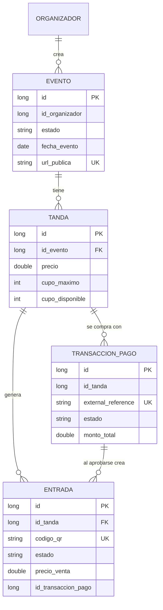

Leído en voz alta: **un organizador crea eventos; cada evento tiene tandas con precio y cupo; cada compra es una orden de pago; cuando se aprueba, nacen las entradas, cada una con su código QR.**

### Todas las tablas

| Grupo | Tabla | Qué guarda |
|---|---|---|
| Usuarios | `usuarios` | Datos comunes: nombre, email, contraseña (hash), rol, estado |
| | `organizadores` | Saldo de créditos, contacto, tope por comprador, comisión, términos aceptados |
| | `staff_qr` | A qué evento está asignado quien escanea |
| | `staff_vendedores` | Organizador, evento y tope de entradas del vendedor |
| | `tokens_recuperacion` | Enlaces para restablecer la contraseña |
| Venta | `eventos` | Nombre, fecha, lugar, estado y enlace público |
| | `tandas` | Precio, cupo máximo y disponible, ventana de venta, si es de cortesía |
| | `entradas` | Código QR, comprador, estado, canal, precio, uso, anulación y reembolso |
| | `transacciones_pago` | Órdenes de compra de entradas |
| Créditos | `paquetes_credito` | Packs que vende la plataforma |
| | `transacciones_credito` | Órdenes de compra de créditos |
| | `movimientos_credito` | Historial: cada suma o resta y el saldo que quedó |
| Mercado Pago | `cuentas_mercadopago` | Cuenta vinculada de cada organizador (tokens cifrados) |
| | `intentos_vinculacion_mp` | Datos temporales mientras se vincula |
| Administración | `configuraciones_sistema` | Parámetros que cambia el admin |
| | `log_auditoria` | Quién hizo qué y cuándo |
| | `notificaciones` | Avisos de la campanita |

### Herencia de usuarios

Hay una tabla `usuarios` y una tabla extra por cada tipo que necesita datos propios. En JPA se llama **herencia `JOINED`**:

```java
@Entity @Table(name = "usuarios")
@Inheritance(strategy = InheritanceType.JOINED)
public class Usuario { ... }

@Entity @Table(name = "organizadores")
@PrimaryKeyJoinColumn(name = "id_usuario")
public class Organizador extends Usuario { private Integer saldoCreditos; ... }
```

Un organizador es **una fila en `usuarios` y otra en `organizadores` con el mismo id**. El administrador no tiene tabla propia: le alcanza con el rol. Ventaja: el login busca en un solo lugar y no quedan columnas vacías. Costo: hay que unir dos tablas.

### Estados: la vida de cada cosa

| Qué | Estados |
|---|---|
| Evento | `Borrador` → `Publicado` → `Cancelado` ("finalizado" no se guarda: se calcula, 12 horas después del inicio) |
| Entrada | `Pagada` → `Usada` o `Anulada` |
| Orden de pago | `Pendiente` → `Aprobada`, `Rechazada`, `Expirada` o `Reembolsada` |
| Usuario | `Activo`, `Suspendido`, `Inactivo` |
| Cuenta de Mercado Pago | `Vinculada`, `Revocada` |

Se guardan como texto (`@Enumerated(EnumType.STRING)`): en la base se lee `Usada` y no un número que cambiaría si se reordenara la lista.

### Relaciones y claves

- **Clave primaria (PK):** el número que identifica cada fila. Todas usan `Long` autoincremental (la excepción es `intentos_vinculacion_mp`, que usa un texto al azar).
- **Clave foránea (FK):** una columna que apunta a otra tabla y que la base controla.
- **Única (UK):** no se puede repetir (email, código QR, referencia de pago, enlace público).

**Algo que conviene decir de frente:** la base solo controla **cinco claves foráneas**: `tandas → eventos`, `entradas → tandas` y las tres tablas hijas de `usuarios`. Las demás relaciones (`id_organizador`, `id_transaccion_pago`, `id_staff_vendedor`…) son **números sueltos** que controla el código. Es más simple de programar, pero la base no impide que apunten a algo que no existe. La mejora es agregar esas claves foráneas. [Verificado en la base local; el motivo es A CONFIRMAR]

### Cosas del modelo que suelen preguntar

| Pregunta | Respuesta |
|---|---|
| ¿Por qué `cupo_disponible` si se puede contar entradas? | Es el número que se descuenta de forma segura al vender, sin contar filas cada vez |
| ¿Por qué `precio_venta` en la entrada? | Si el organizador cambia el precio de la tanda, lo ya vendido no se mueve (ingresos y reembolsos usan ese valor) |
| ¿Por qué `movimientos_credito` si ya está el saldo? | Para poder explicar cómo se llegó al saldo |
| ¿Por qué la orden está separada de la entrada? | Se puede intentar pagar y no pagar nunca: la entrada existe solo si el pago se aprueba |
| ¿Se borran datos? | Los eventos se cancelan y las entradas se anulan; solo se borra lo que no tiene historia (un borrador, por ejemplo) |

### Cómo cambia el esquema

`ddl-auto: update` crea tablas y columnas nuevas al arrancar. Lo que no hace (cambiar restricciones, completar datos viejos) va en 14 scripts de `backend/db/migraciones`.

Un efecto real: el código declara único el identificador de pago de Mercado Pago, pero en una base creada antes de ese cambio **la restricción puede no estar** (en la local no está). Los pagos repetidos igual se evitan porque se bloquea la orden y se revisa su estado. Es un buen ejemplo de por qué conviene Flyway.

### Los puntos flojos

- Dinero guardado como `Double`; lo correcto es `BigDecimal` / `numeric`.
- Pocas claves foráneas.
- Migraciones manuales.

### Lo que tenés que saber

- El recorrido: organizador → evento → tanda → orden → entrada.
- Herencia `JOINED`: dos filas con el mismo id.
- Los estados de evento, entrada y orden.
- Qué controla la base y qué controla el código.

### Repaso

**1. ¿Por qué una base relacional?**
Los datos están muy conectados y la venta necesita transacciones: descontar cupo, aprobar la orden y crear las entradas juntas.

**2. ¿Qué es una transacción?**
Un grupo de cambios que se aplican todos o ninguno. Si falla la creación de una entrada, tampoco se descuenta el cupo.

**3. ¿Cómo evitan dos entradas con el mismo QR?**
El código es al azar y la columna es única.

**4. ¿Qué relaciones controla la base?**
Evento-tanda, tanda-entrada y la herencia de usuarios. El resto lo controla el código; es una mejora pendiente.

**5. ¿Dónde se guardan las contraseñas?**
Solo su hash BCrypt, en `usuarios.password_hash`. La contraseña original no se puede recuperar.

---

## 8. Backend

### En palabras simples

El backend es la cocina del restaurante: el cliente (la pantalla) pide, y la cocina decide si se puede, lo prepara y responde. **Las reglas importantes viven acá**, porque lo que está en el navegador se puede modificar.

### Cómo está organizado

| Carpeta | Para qué | Ejemplo |
|---|---|---|
| `controllers` | Reciben el pedido HTTP y devuelven la respuesta | `VentaController` |
| `services` | Reglas de negocio y transacciones | `VentaService` |
| `repositories` | Consultas a la base | `TandaRepository` |
| `models/entities` | Tablas | `Entrada` |
| `models/dtos` | Lo que entra y sale de la API | `CompraOnlineRequestDTO` |
| `security` | Login, roles, límite de pedidos, auditoría | `SecurityConfig` |
| `exceptions` | Errores propios y su respuesta | `GlobalExceptionHandler` |
| `config` | Arranque y comprobaciones | `ConfiguracionProdValidator` |

Un **DTO** es un formulario: define exactamente qué campos se aceptan y cuáles se devuelven. Así no se expone la tabla entera (por ejemplo, el hash de la contraseña).

### Endpoints

Un **endpoint** es una dirección a la que se le puede pedir algo. Son **92** (contados en `frontend/openapi.json`). La documentación navegable está en `/swagger-ui.html`.

| Área | Ruta base | Quién |
|---|---|---|
| Autenticación | `/auth` | Público |
| Catálogo e información | `/public/**` | Público |
| Compra y consulta de orden | `/tickets/comprar-online`, `/tickets/orden/{ref}` | Público |
| Ver una entrada | `/tickets/by-codigo`, `/tickets/{id}/qr-image` | Quien tiene el código (o el organizador dueño) |
| Aviso de pago | `/payments/mercadopago/webhook` | Mercado Pago (con firma) |
| Eventos y tandas | `/eventos/**` | Organizador (una lista, para el vendedor) |
| Staff, perfil, créditos | `/organizador/**`, `/creditos/**` | Organizador |
| Anulaciones y reembolsos | `/tickets/{id}/anular`, `/reembolsar` | Organizador |
| Validación | `/tickets/validate` | Staff QR |
| Venta en puerta | `/tickets/venta-manual` | Staff Vendedor |
| Notificaciones | `/notificaciones` | Cualquier usuario con sesión |
| Administración | `/admin/**` | Administrador |

Verbos: `GET` consulta, `POST` crea o ejecuta, `PUT` reemplaza, `PATCH` cambia una parte (publicar, cancelar), `DELETE` borra.

### Un pedido de principio a fin

```java
// 1. Controlador: recibe, valida el formato y delega
@PostMapping("/login")
public ResponseEntity<AuthResponseDTO> login(@Valid @RequestBody LoginRequestDTO dto) {
    return ResponseEntity.ok(authService.login(dto));
}
// 2. Servicio: aplica las reglas      3. Repositorio: consulta la base
```

Antes de llegar al controlador, el pedido pasa por dos **filtros**: el límite de pedidos (`RateLimitFilter`) y el lector del token (`JwtAuthenticationFilter`).

### Tres niveles de validación

| Nivel | Pregunta | Ejemplo |
|---|---|---|
| **Formato** (DTO con `@Valid`) | ¿El dato tiene forma correcta? | Email válido; entre 1 y 20 entradas; contraseña de 8 o más |
| **Permiso** (roles y dueño) | ¿Podés hacerlo vos, sobre esto? | `@PreAuthorize("hasRole('Organizador')")` y "¿es tu evento?" |
| **Negocio** (servicio) | ¿Se puede en este momento? | Hay cupo, la tanda está abierta, alcanzan los créditos |

El segundo nivel tiene dos mitades. El rol solo dice "sos organizador"; falta comprobar que el evento sea tuyo:

```java
if (!evento.getIdOrganizador().equals(idOrganizador)) {
    throw new ForbiddenActionException("No tenés permiso para acceder a este evento");
}
```

Sin esa comprobación, un organizador podría tocar eventos ajenos cambiando el número en la dirección (vulnerabilidad **IDOR**). El id del organizador sale del token, nunca de lo que manda el navegador.

### Las reglas de negocio principales

| Regla | Dónde |
|---|---|
| Crear una tanda consume 1 crédito por entrada; bajar el cupo o eliminarla los devuelve | `TandaService` |
| Publicar consume el costo de publicación (1 por defecto, configurable) | `EventoService.publicarEvento` |
| Para publicar: borrador, al menos una tanda de venta, fecha futura, Mercado Pago vinculado, contacto cargado y saldo | Ídem |
| No se vende más que el cupo | `TandaRepository.findByIdWithLock` y `decrementarCupo` |
| Tope de entradas por persona y por evento (6 por defecto) | `LimiteCompradorService`, `VentaService` |
| La venta sigue hasta que el evento finaliza (inicio + 12 horas) | `Evento.yaFinalizo` |
| El vendedor no supera su tope | `VentaService.validarTopeDelVendedor` |
| Cada entrada se usa una sola vez | `StaffQRService`, `EntradaRepository.marcarComoUsada` |

### Errores

Un solo lugar (`GlobalExceptionHandler`) convierte cualquier error en la misma forma de respuesta:

```json
{ "status": 409, "error": "La tanda está agotada", "path": "/tickets/comprar-online", "timestamp": "..." }
```

| Código | Significa | Cuándo |
|---|---|---|
| 400 | Datos mal formados | Falla `@Valid` (incluye el detalle por campo) |
| 401 | No sé quién sos | Credenciales incorrectas |
| 403 | Sé quién sos, no podés | Otro rol, evento ajeno, cuenta suspendida |
| 404 | No existe | Evento o entrada inexistente |
| 409 | Choca con una regla | `BusinessRuleException`: sin cupo, sin créditos |
| 429 | Demasiados pedidos | Límite superado |
| 502 | Falló Mercado Pago | `PasarelaPagoException` |
| 500 | Error inesperado | Mensaje genérico; el detalle queda en el log |

### Trabajo en segundo plano

| Qué | Cada cuánto | Para qué |
|---|---|---|
| `VencimientoOrdenesJob` | 10 minutos | Consulta a Mercado Pago las órdenes vencidas (30 minutos) y, si no se pagaron, las marca `Expirada` |
| `RenovacionTokensMpJob` | 6 horas | Renueva los permisos de las cuentas de Mercado Pago |
| Correos (`@Async`) | Cuando ocurren | No hacen esperar al usuario; si fallan, la operación no se deshace |

### Auditoría

Los métodos marcados con `@Auditable` dejan una fila con quién, qué y sobre qué (`AuditoriaAspect`). Es **programación orientada a aspectos**: el registro se agrega "por fuera" sin mezclarlo con la regla.

### Los puntos flojos del backend

Leídos en el código, **sin reproducir**; son carreras (dos operaciones al mismo instante) poco probables:

- **Saldo de créditos:** `CreditoLedgerService` lee el saldo, suma y guarda sin bloquear. Dos operaciones simultáneas del mismo organizador podrían pisarse.
- **Editar una tanda mientras se vende:** `TandaService.actualizarTanda` no bloquea la tanda y podría reponer el cupo recién descontado.
- **Anular mientras se escanea** (ver 5.10).

La mejora es la misma que ya usa la venta: bloquear la fila o actualizar con una condición. **Díganlo así si preguntan por concurrencia**: la venta, el pago y el ingreso están protegidos; la edición y los créditos, todavía no.

### Lo que tenés que saber

- Las capas y qué hace cada una.
- Los tres niveles de validación y qué es IDOR.
- La diferencia entre 401, 403 y 409.
- Qué hacen los dos trabajos programados.

### Repaso

**1. ¿Por qué no poner la lógica en el controlador?**
Porque la misma regla se usa desde varios lugares y así se prueba sin levantar la web.

**2. ¿Para qué sirven los DTO?**
Para decidir exactamente qué entra y qué sale, sin exponer las tablas.

**3. ¿Qué pasa si alguien llama a la API sin usar la pantalla?**
Se encuentra con las mismas validaciones: todas están en el backend.

**4. ¿Qué es `@Transactional`?**
Marca que todo el método es una transacción: si lanza un error de ejecución, se deshacen los cambios.

**5. ¿Por qué las llamadas a Mercado Pago van fuera de la transacción?**
Porque dependen de internet: mientras responde, no queremos retener una conexión a la base.

---

## 9. Frontend

### En palabras simples

El frontend es lo que se ve y se toca. Es una **SPA** (aplicación de una sola página): el navegador la descarga una vez y después cambia de pantalla sin recargar, pidiéndole datos a la API.

### Estructura (`frontend/src`)

| Carpeta | Contenido |
|---|---|
| `App.tsx` | El mapa de rutas |
| `pages/buyer` | Catálogo, detalle, compra, resultado del pago, mi entrada |
| `pages/organizador` | Panel, asistente de creación, evento, créditos, staff, perfil |
| `pages/staff` | Login, escáner y punto de venta |
| `pages/admin` | Panel, usuarios, eventos, configuración, auditoría |
| `pages/ayuda`, `pages/legal` | Guías de uso, términos y privacidad |
| `components` y `components/ui` | Piezas reutilizables (botones, campos, tarjetas) |
| `lib` | Conexión con la API, sesión, tipos, formatos |
| `styles` | Colores y tipografías |

### Navegación

| Quién | Rutas principales |
|---|---|
| Comprador (sin cuenta) | `/`, `/eventos`, `/eventos/:urlPublica`, `/checkout`, `/pago/resultado`, `/mi-entrada` |
| Organizador | `/organizador/dashboard`, `/crear`, `/eventos/:id`, `/creditos`, `/staff`, `/perfil` |
| Staff | `/staff/login`, `/staff/scanner`, `/staff/pos` |
| Administrador | `/admin/dashboard`, `/usuarios`, `/eventos`, `/config`, `/auditoria` |

Las rutas privadas están envueltas en un guardián:

```tsx
export function RequireRole({ roles, redirectTo = "/", children }) {
  const { session } = useAuth();
  if (!session || !roles.includes(session.rol)) return <Navigate to={redirectTo} replace />;
  return <>{children}</>;
}
```

**Importante:** esto es **comodidad, no seguridad**. Alguien podría saltearlo desde el navegador y vería una pantalla vacía, porque el backend rechaza sus pedidos.

Las pantallas se cargan **bajo demanda** (`lazy`): un comprador no descarga el panel de administración.

### Conexión con la API

Todo pasa por un solo archivo, `lib/api.ts`:

```ts
const token = getStoredToken();
if (token) headers["Authorization"] = `Bearer ${token}`;
const response = await fetch(`${API_BASE_URL}${path}`, { method, headers, body });
if (!response.ok) throw new ApiError(data);
```

Centraliza cuatro cosas: la dirección del backend (`VITE_API_BASE_URL`), el token, la forma de los errores y el cierre de sesión cuando el token venció.

### Contrato entre backend y frontend

Si el backend cambia un campo y la pantalla no se entera, algo se rompe en silencio. Para evitarlo:

1. Se genera `openapi.json` desde el backend (`npm run types:api`).
2. `lib/types.contract.ts` compara esos tipos con los que usa la pantalla: **si difieren, no compila**.
3. Una prueba del backend (`OpenApiContratoTest`) falla si la copia quedó vieja.

### Estado y datos

No hay librería de estado global: cada pantalla usa `useState` y `useEffect`, y hay **contextos** para lo compartido (sesión, tema y diálogos). Alcanza para el tamaño actual; con más pantallas que compartan datos convendría una librería de consultas con caché. [INFERIDA]

La sesión se guarda en `localStorage` (ver la decisión 5.8).

### Diseño

- Reglas en `docs/tecnica/DESIGN.md`: colores como variables (`--primary`, `--card`…), tipografías y patrones de componentes.
- **Responsive:** en computadora, barra lateral; en celular, barra inferior.
- Tema claro y oscuro.
- Estados de carga, error y vacío en las pantallas.
- Escáner pensado para la puerta: pantalla completa, linterna, ingreso manual del código y aviso para lectores de pantalla.

### Los puntos flojos del frontend

- El token en `localStorage`.
- La compra depende de la navegación: los datos de la tanda viajan desde la pantalla del evento, así que entrar directo a `/checkout` no sirve y esos datos pueden quedar viejos (el servidor vuelve a validar todo).
- Sin modo sin conexión.

### Lo que tenés que saber

- Qué es una SPA y cómo se conecta con la API.
- Que proteger rutas en el frontend no es seguridad.
- Cómo se evita que backend y frontend se desfasen.

### Repaso

**1. ¿Por qué TypeScript?**
Detecta errores de tipos antes de ejecutar, por ejemplo usar un campo que la API ya no devuelve.

**2. ¿Qué pasa cuando vence la sesión?**
El backend rechaza el pedido y `api.ts` borra la sesión y lleva al login del rol.

**3. ¿Cómo lee el QR el celular?**
Con la cámara del navegador y la librería `html5-qrcode`; requiere permiso y una página segura (HTTPS, o `localhost`).

**4. ¿Qué hace la pantalla de resultado del pago?**
Consulta la orden cada 4 segundos, hasta 10 minutos, mientras siga pendiente.

---

## 10. Flujos completos

### Cómo leer los diagramas

Un **diagrama de secuencia** se lee de arriba hacia abajo: cada columna es un participante y cada flecha, un mensaje. Flecha llena: pedido. Punteada: respuesta. Los bloques `alt` son "si pasa esto… si no…".

Debajo de cada uno está **qué puede salir mal**.

| # | Flujo | Quién |
|---|---|---|
| 10.1 | Registro y login | Organizador y demás usuarios |
| 10.2 | Creación y publicación de un evento | Organizador |
| 10.3 | Compra | Comprador |
| 10.4 | Pago y emisión de entradas | Mercado Pago y sistema |
| 10.5 | El código QR | Comprador |
| 10.6 | Ingreso | Staff QR |
| 10.7 | Venta en puerta | Staff Vendedor |
| 10.8 | Cancelación, anulación y reembolso | Organizador o admin |
| 10.9 | Compra de créditos | Organizador |
| 10.10 | Recuperar contraseña | Cualquier usuario |

### 10.1 Registro y login

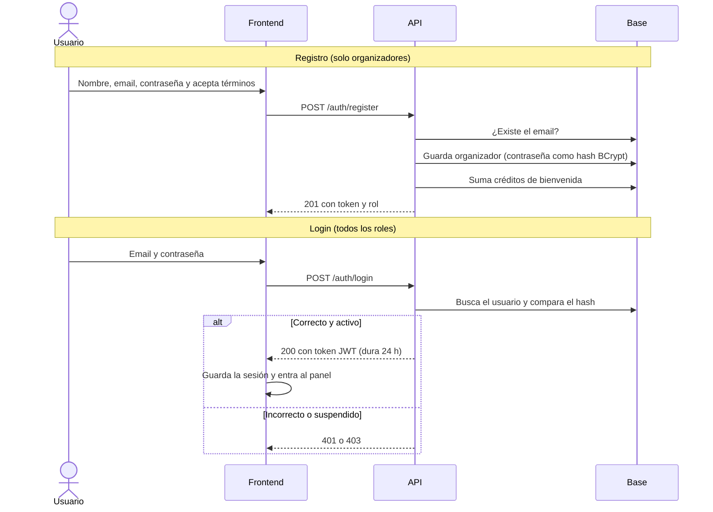

En cada pedido siguiente, el filtro lee el token, **vuelve a buscar al usuario en la base** y comprueba que siga activo.

| Qué puede salir mal | Respuesta |
|---|---|
| Email ya registrado | 409 |
| Contraseña de menos de 8 caracteres o sin aceptar términos | 400 con el campo |
| Contraseña incorrecta | 401 |
| Más de 5 intentos por minuto desde la misma conexión | 429 |
| Cuenta suspendida | 403; los tokens que ya tenía dejan de servir |

Las cuentas de staff las crea el organizador: reciben una contraseña temporal por correo. El primer administrador se crea al arrancar (`AdminInicialSeeder`).

Código: `AuthController`, `AuthService`, `JwtAuthenticationFilter`.

### 10.2 Creación y publicación de un evento

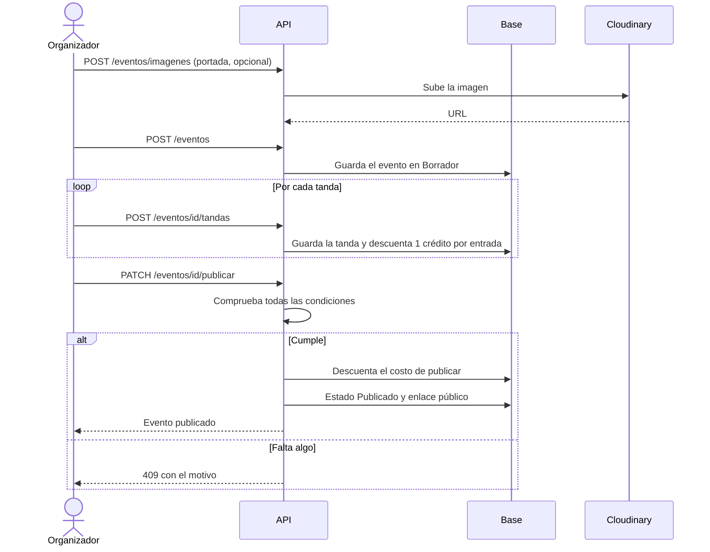

| Condición para publicar | Si falta |
|---|---|
| Estar en borrador | No se puede publicar dos veces |
| Al menos una tanda que se venda | Las de cortesía no cuentan |
| Fecha futura | Se rechaza |
| Ventanas de venta dentro del evento | Hay que ajustarlas |
| Cuenta de Mercado Pago vinculada | Se vincula desde Mi perfil (en la demo esta exigencia está desactivada) |
| Contacto cargado | Es el que usa el botón de arrepentimiento |
| Créditos para publicar | Se compran créditos |

Ejemplo: un evento con 100 entradas consume **101 créditos** con el costo de publicación por defecto. Por eso al armar tandas se **reserva** ese crédito.

Código: `EventoService`, `TandaService`, `CreditoLedgerService`; pantalla `WizardPage.tsx`.

### 10.3 Compra

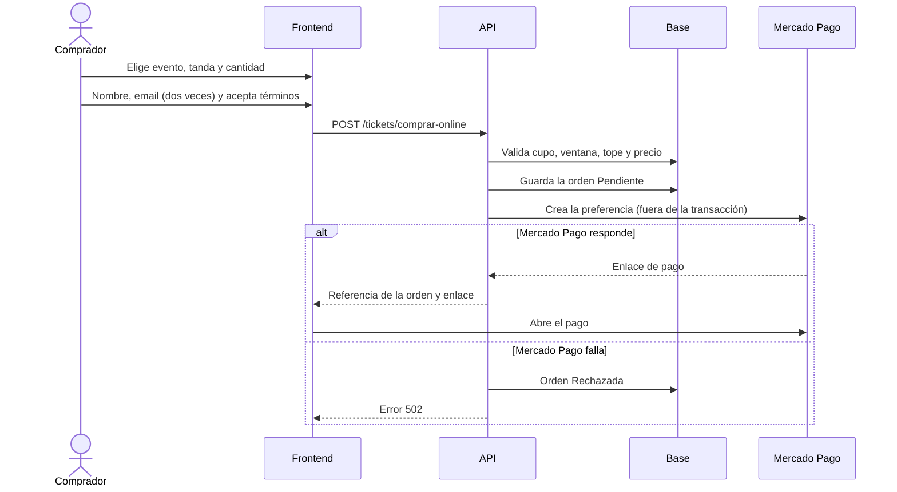

Tres ideas:

- **El precio lo pone el servidor.** El navegador solo manda qué tanda y cuántas.
- La **referencia externa** es un código al azar que une la orden con el pago.
- **Todavía no hay entradas ni se descontó cupo.**

| Qué puede salir mal | Respuesta |
|---|---|
| Tanda agotada, cerrada, de cortesía o evento no publicado | 409 |
| Supera el tope por persona | 409 |
| Más de 20 entradas o email inválido | 400 |
| El organizador perdió el acceso a su cuenta de cobro | 409: "este evento no puede cobrar online" |
| El navegador bloquea la ventana de pago (en local) | La pantalla pide permitir ventanas emergentes |

Código: `CheckoutPage.tsx`, `lib/pago.ts`, `VentaService.iniciarCompraOnline`.

### 10.4 Pago y emisión de entradas ★

Es el flujo más importante.

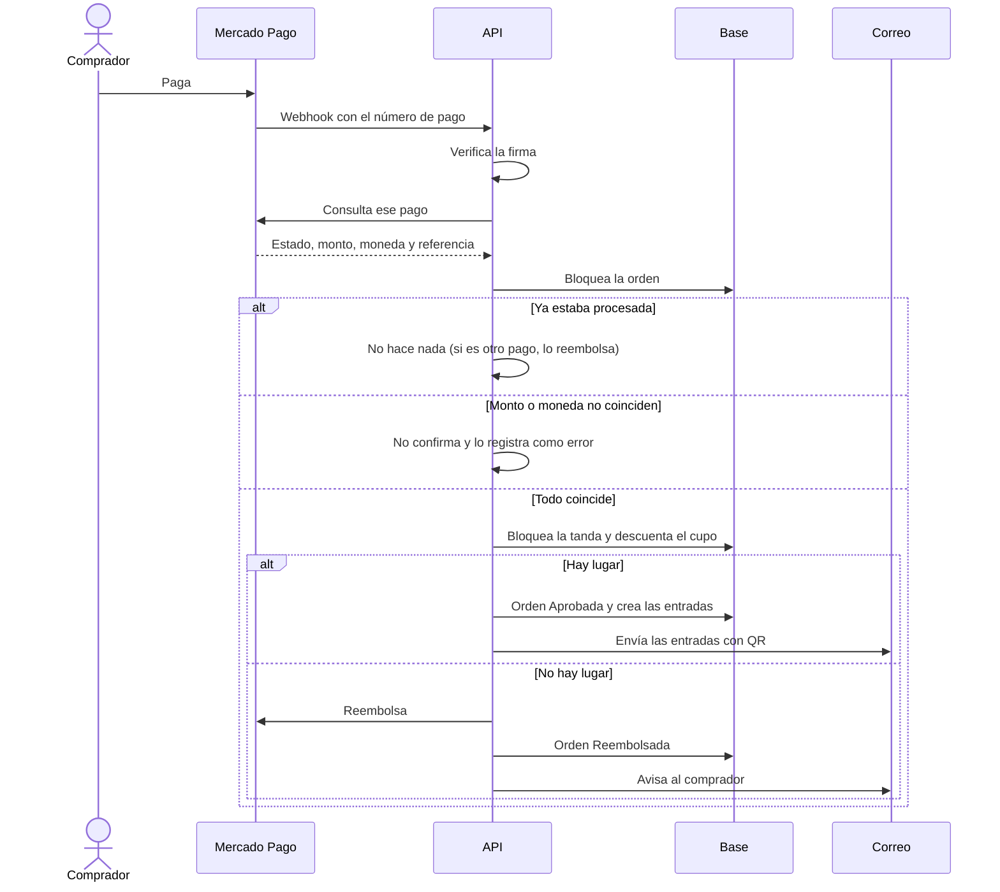

**Si el aviso nunca llega** hay dos redes de seguridad que preguntan a Mercado Pago por la referencia (**reconciliación**):

1. La pantalla de resultado consulta `GET /tickets/orden/{ref}` mientras la orden siga pendiente.
2. El trabajo programado revisa las órdenes vencidas antes de marcarlas como expiradas.

| Defensa | Contra qué |
|---|---|
| Firma del webhook | Avisos inventados |
| Consultar el pago a Mercado Pago | No creer lo que dice el aviso |
| Comparar monto y moneda | Pagar menos de lo que corresponde |
| Bloquear la orden y mirar su estado | Avisos repetidos (idempotencia) |
| Bloquear la tanda | Vender de más |

```java
Tanda tanda = tandaRepository.findByIdWithLock(transaccion.getIdTanda()).orElse(null);
if (tanda == null || tanda.getEvento().getEstado() != EstadoEvento.Publicado
        || excedeLimitePorComprador(tanda, transaccion.getEmailComprador(), cantidad)
        || tandaRepository.decrementarCupo(tanda.getId(), cantidad) == 0) {
    return ConfirmacionEntradas.sinEntradas(ResultadoPago.SIN_DISPONIBILIDAD);
}
```

Código: `MercadoPagoWebhookController`, `PagoWebhookService`, `VentaService.confirmarPagoEntradas`, `VencimientoOrdenesJob`.

### 10.5 El código QR

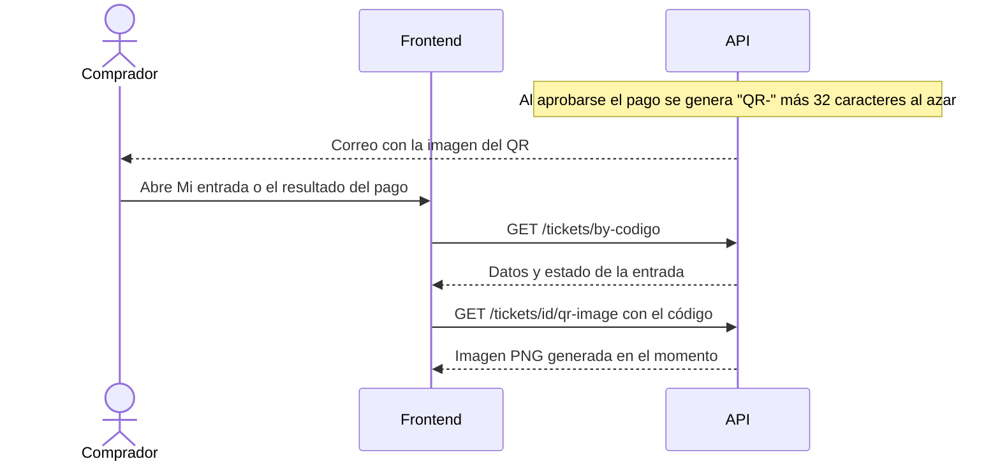

- La imagen **no se guarda**: se dibuja cuando se pide (ZXing, `QrImageService`).
- El QR contiene **solo el código**, sin nombre ni precio.
- Quien tiene el código puede ver la entrada: **es como la entrada de papel, no hay que compartirla**.

| Qué puede salir mal | Qué pasa |
|---|---|
| No llega el correo | La pantalla de resultado muestra las entradas y permite copiar el enlace |
| Pedir la imagen sin el código correcto | 403 (salvo el organizador dueño) |
| Adivinar un código | En la práctica no se puede: 32 caracteres al azar |

### 10.6 Ingreso

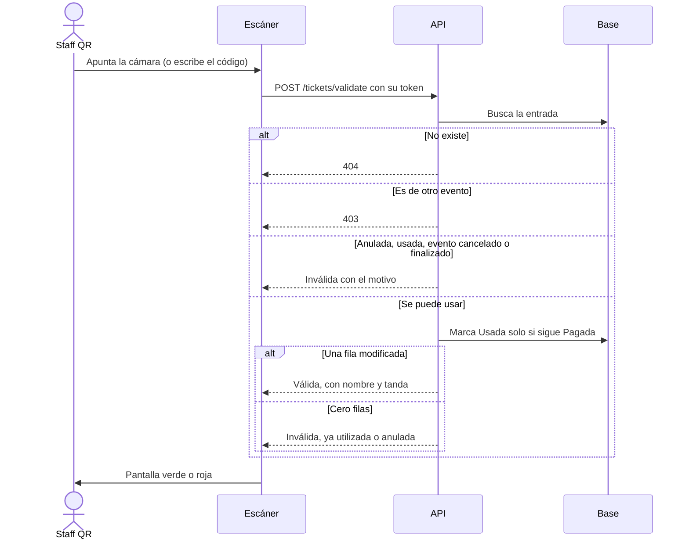

El escáner ignora nuevas lecturas mientras muestra un resultado, para no mandar el mismo código muchas veces. Cada ingreso, aceptado o rechazado, queda en la auditoría.

| Intento de fraude | Por qué no funciona |
|---|---|
| Mostrar una captura ya usada | La entrada está `Usada` |
| Dos personas con la misma captura en dos puertas a la vez | Solo una marca la fila |
| Inventar un QR | No existe en la base |
| Usar la entrada de otro evento | El staff solo valida el suyo |

Sin internet no se puede validar.

Código: `ScannerPage.tsx`, `StaffQRService.validarQR`.

### 10.7 Venta en puerta

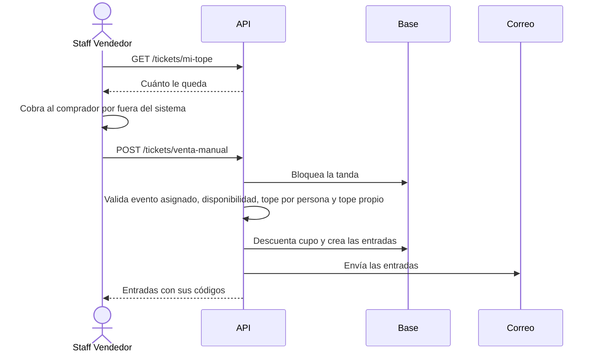

- No pasa por Mercado Pago: el sistema **registra** la venta y el dinero se rinde aparte. El organizador ve cuánto vendió cada uno.
- Todo o nada: si no alcanza el cupo, no se crea ninguna.

| Qué puede salir mal | Respuesta |
|---|---|
| Tanda de otro organizador o evento | 403 |
| Sin cupo o venta cerrada | 409 |
| Supera su tope | 409 con cuántas le quedan |
| Falla el correo | La venta vale igual |

Además, el **organizador** puede emitir entradas de cortesía o ya pagadas por fuera (`/tickets/emision-organizador`). Salen del cupo.

Código: `PosPage.tsx`, `VentaService.realizarVentaManual`.

### 10.8 Cancelación, anulación y reembolso

Son tres cosas distintas:

| Acción | Qué hace |
|---|---|
| **Cancelar el evento** | Corta la venta y el ingreso, avisa por correo y devuelve los créditos de lo no vendido |
| **Anular una entrada** | Esa entrada deja de valer; puede incluir el reembolso |
| **Reembolsar** | Devuelve el dinero por Mercado Pago |

**Cancelar no devuelve el dinero solo:** el organizador lo hace después, de a una o todas juntas.

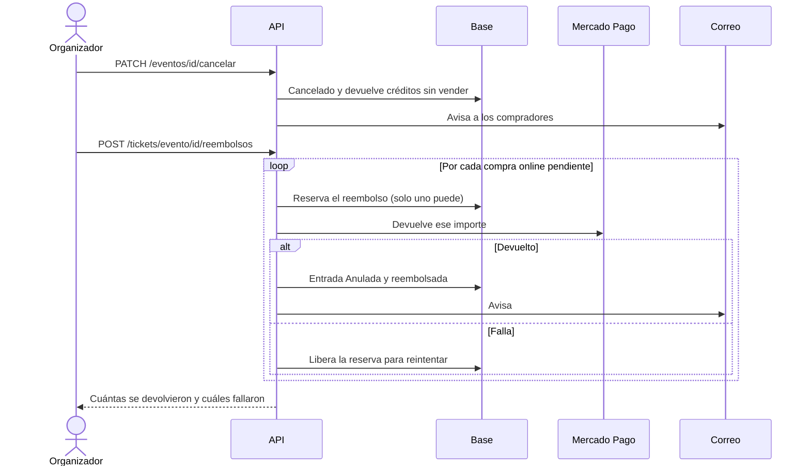

| Regla | Detalle |
|---|---|
| Quién cancela | El organizador, hasta que empieza; el administrador, hasta que finaliza |
| Qué se devuelve | Lo que pagó el comprador por esa entrada, incluido el cargo si se le trasladó |
| Qué no se reembolsa desde el sistema | Ventas en puerta, cortesías y pagos externos |
| Entrada usada | No se puede anular |
| Créditos | Vuelven al anular, salvo que el evento ya haya finalizado |
| Arrepentimiento | El botón deriva al contacto del organizador; el comprador no se reembolsa solo |

| Qué puede salir mal | Qué pasa |
|---|---|
| El organizador no tiene saldo en Mercado Pago o revocó el acceso | Falla esa devolución y se puede reintentar |
| Doble clic en reembolsar | La reserva deja pasar solo uno |

Si se devuelve el dinero **directamente desde el panel de Mercado Pago**, una orden ya aprobada no cambia y sus entradas **siguen valiendo**: hay que anularlas desde el sistema (`VentaService.marcarOrdenReembolsada`). [Leído en el código, sin probar]

Código: `EventoService.cancelarEvento`, `AdminEventoService`, `ReembolsoEntradaService`, `AnulacionEntradaService`.

### 10.9 Compra de créditos

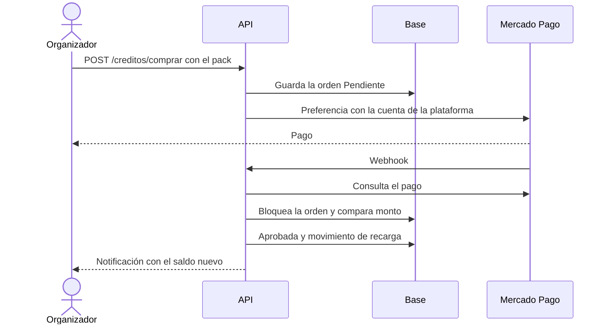

La diferencia clave con las entradas: **los créditos los cobra la plataforma; las entradas, el organizador.**

| Qué puede salir mal | Qué pasa |
|---|---|
| Pack deshabilitado | 409 |
| Pago repetido | No se acredita dos veces |
| Monto distinto | No se acredita |
| Nunca se paga | La orden vence |

Código: `CreditoService`, `PagoWebhookService`, `WalletPage.tsx`.

### 10.10 Recuperar contraseña

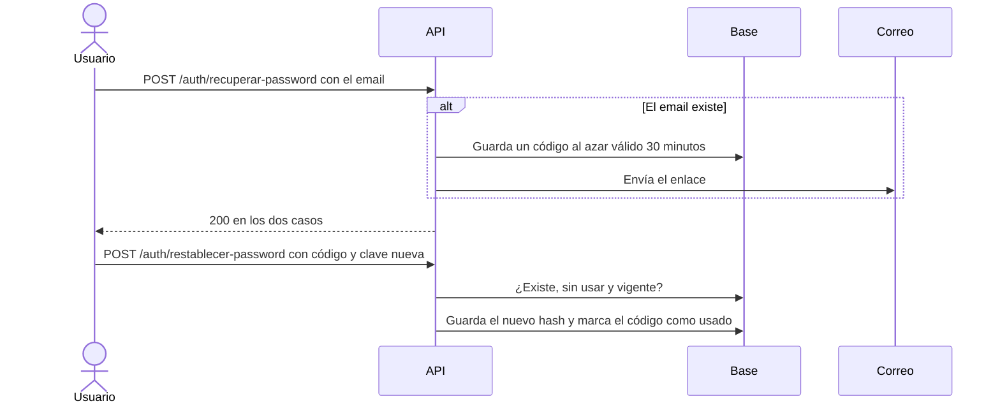

- Responde **igual exista o no el email**, para no revelar quién tiene cuenta.
- El enlace sirve **una vez** y por **30 minutos**.
- Límite: 3 pedidos cada 5 minutos.

| Qué puede salir mal | Respuesta |
|---|---|
| Código inválido, usado o vencido | 409 |
| Clave nueva corta | 400 |

Mejoras posibles: las sesiones abiertas **siguen valiendo** hasta vencer, y los pedidos anteriores no se invalidan. [Leído en `PasswordRecoveryService`]

### Lo que tenés que saber

- Contar de memoria **10.4** (pago) y **10.6** (ingreso): son los que más van a preguntar.
- Cuándo se descuenta el cupo en cada canal: online, **al confirmar el pago**; en puerta, **al vender**.
- Cancelar, anular y reembolsar no son lo mismo.

### Repaso

**1. ¿Qué pasa si dos personas compran la última entrada a la vez?**
Las dos pueden llegar a pagar. Al confirmar, la primera se lleva la entrada y a la segunda se le reembolsa.

**2. ¿Qué pasa si Mercado Pago no manda el aviso?**
La reconciliación consulta el pago desde la pantalla de resultado o desde el trabajo programado.

**3. ¿Y si manda el aviso diez veces?**
La orden ya está aprobada: no se crean entradas nuevas.

**4. ¿Puedo pagar menos modificando el navegador?**
No: el precio lo calcula el servidor y al confirmar se compara el monto cobrado.

**5. ¿Qué pasa si se cierra el navegador después de pagar?**
Las entradas se crean igual y llegan por correo.

---

## 11. Seguridad ★

### En palabras simples

Seguridad es responder cuatro preguntas en cada pedido: **¿quién sos?** (autenticación), **¿podés hacer esto?** (autorización), **¿esto es tuyo?** (propiedad) y **¿lo que mandás tiene sentido?** (validación).

Analogía de un recital: la pulsera dice quién sos; el color dice a qué sector entrás; y aunque seas del personal, no podés abrir el camarín de otra banda.

**Idea central: nada de lo que viene del navegador o del celular se da por cierto.** El precio, el dueño de un evento, el estado de un pago y la validez de una entrada los decide el servidor.

### Sesión: JWT

Al iniciar sesión, el backend entrega un **JWT**: un texto con tres partes separadas por puntos.

| Parte | Contiene |
|---|---|
| Encabezado | Cómo está firmado |
| Datos | Email, id, rol y vencimiento (24 horas) |
| Firma | Un sello calculado con la clave secreta del servidor |

- Los datos **se pueden leer** (no están cifrados), por eso no llevan nada secreto.
- **No se pueden modificar**: si alguien cambia el rol, la firma deja de coincidir.
- El servidor no guarda sesiones.

```java
UserDetails userDetails = userDetailsService.loadUserByUsername(userEmail);
if (userDetails.isEnabled() && jwtUtils.isTokenValid(jwt, userDetails)) { ... }
```

En cada pedido se **vuelve a leer el usuario de la base**: por eso una cuenta suspendida deja de funcionar al instante, aunque su token no haya vencido (`JwtAuthenticationFilter`).

En producción el backend **no arranca** si la clave es la de desarrollo, que es pública (`JwtSecretValidator`).

### Contraseñas

Se guarda un **hash BCrypt**: una huella que no se puede revertir, lenta a propósito y distinta para cada usuario aunque repitan la contraseña. Al iniciar sesión se compara la huella.

### Roles y propiedad

| Rol | Puede |
|---|---|
| `Administrador` | Usuarios, eventos de todos, configuración, auditoría |
| `Organizador` | Sus eventos, tandas, staff, créditos y reembolsos |
| `Staff_QR` | Validar entradas de su evento |
| `Staff_Vendedor` | Vender el evento asignado, hasta su tope |
| Sin cuenta (comprador) | Ver el catálogo, comprar y ver su entrada |

Dos controles: `@PreAuthorize` (rol) y la comprobación de dueño en el servicio. El segundo evita **IDOR**.

### ¿Se puede reutilizar una entrada?

No para ingresar dos veces. El primer escaneo la marca `Usada` con una sola orden condicionada (ver 5.10 y 10.6), incluso si llegan varios a la vez.

**El riesgo que queda:** si alguien comparte su QR, **entra el primero que llega**. El sistema garantiza un solo ingreso, no quién es la persona. Se avisa al comprador; la mejora sería pedir documento o un QR que cambie en una aplicación.

### ¿Se puede falsificar una entrada?

| Intento | Qué pasa |
|---|---|
| Inventar un código | Tiene 32 caracteres al azar y no existe en la base |
| Editar la imagen o el PDF | El servidor solo mira el código |
| Copiar el diseño con otro código | "No encontrada" |
| Usar una entrada de otro evento | Rechazada |
| Usar una anulada o de un evento cancelado | Rechazada |
| Crearse una cuenta de Staff QR | Solo las crea el organizador, para sus eventos |

**30 segundos:** "El QR no se valida por cómo se ve: se valida contra la base. Para falsificarlo habría que adivinar un código al azar, y para reutilizarlo, ganarle a la primera persona que entró."

### Pagos

| Amenaza | Defensa |
|---|---|
| Aviso de pago inventado | Firma HMAC-SHA256 del webhook |
| Aviso verdadero con datos alterados | El pago se vuelve a consultar a Mercado Pago |
| Pagar menos | Se comparan monto y moneda con la orden |
| Aviso repetido | Orden bloqueada y estado revisado |
| Robar datos de tarjetas | La aplicación nunca los recibe |

La comparación de la firma usa `MessageDigest.isEqual`, que tarda lo mismo acierte o no (evita adivinarla midiendo tiempos).

En el entorno local la validación de firma se puede apagar (`MP_VALIDAR_FIRMA=false`) por una particularidad del sandbox; **en producción debe estar en `true`**, y falta confirmarlo con un pago real (ver 16).

### La cuenta de Mercado Pago del organizador

- Se vincula con **OAuth**: el organizador autoriza en Mercado Pago y **nunca nos da su contraseña**.
- El pedido lleva un `state` de un solo uso, válido 10 minutos, y **PKCE** (una prueba de que quien completa es quien empezó).
- Los permisos (**tokens**) se guardan **cifrados con AES-256-GCM**, con un valor inicial distinto cada vez (`TokenCifradoService`). Si alguien copia la base, no le sirven sin la clave.

### Otros ataques

| Ataque | Qué es | Situación |
|---|---|---|
| Inyección SQL | Colar órdenes a la base en un campo | Consultas con parámetros (Spring Data) |
| XSS | Colar código en la página | React escapa el texto; en los correos se escapa a mano (`HtmlUtils`) |
| CSRF | Que otra página actúe con tu sesión | No aplica: el token viaja en un encabezado, no en una cookie |
| Fuerza bruta | Probar contraseñas | 5 intentos de login por minuto por IP |
| Averiguar quién tiene cuenta | Mirar las respuestas | Recuperar contraseña responde igual (el registro sí avisa si el email existe) |
| Fuga de secretos | Claves en el código | Variables de entorno; `.env` fuera de Git |
| Errores que revelan detalles | Trazas en la respuesta | Mensaje genérico en errores internos |
| Orígenes ajenos | Otra web llamando a la API desde el navegador | CORS con lista de orígenes |

**CORS no protege la API de un programa que la llame directamente**: para eso están el token y los roles.

### Auditoría

Quién hizo qué, sobre qué y cuándo; las contraseñas se enmascaran. Solo la ve el administrador.

### Los puntos flojos (con su mejora)

| Punto | Riesgo | Mejora |
|---|---|---|
| Token en `localStorage` | Un XSS podría leerlo | Cookie `HttpOnly` con dominio propio |
| Cambiar la contraseña no cierra las sesiones | Un token robado dura hasta 24 h | Versión de sesión o lista de revocados |
| Límite de pedidos solo en login, recuperación, consulta de orden y webhook, y en memoria | Abuso del registro o de la compra | Ampliarlo y compartirlo |
| Ver una entrada requiere solo el código (muestra nombre y email) | Compartir el enlace expone esos datos | Mostrar datos parciales |
| La documentación de la API (Swagger) queda pública | Facilita explorarla | Apagarla en producción |
| Sin segundo factor | Cuenta de admin con una sola barrera | Agregar 2FA |

**No hubo una auditoría de seguridad externa ni pruebas de intrusión.** Hay una lista de criterios (`docs/tecnica/SECURITY.md`), revisiones propias y pruebas automáticas.

### Lo que tenés que saber

- Autenticación, autorización y propiedad, con un ejemplo de cada una.
- Qué tiene un JWT y por qué no se puede alterar.
- Las dos respuestas: reutilizar y falsificar.
- Las cuatro defensas del pago.
- Tres puntos flojos y su mejora.

### Repaso

**1. Si cambio el rol dentro de mi token, ¿soy admin?**
No: la firma deja de coincidir. Además los permisos salen del usuario leído de la base.

**2. ¿Hash o cifrado?**
La contraseña se guarda con hash (no se recupera). Los tokens de Mercado Pago se cifran porque hay que volver a usarlos.

**3. ¿Qué pasa si roban el celular de un Staff QR?**
Podría validar entradas de ese evento. El organizador desactiva la cuenta y deja de funcionar en el siguiente pedido.

**4. ¿Y si alguien llama al webhook a mano?**
Sin firma válida se rechaza; y aunque pasara, el pago se consulta a Mercado Pago.

**5. ¿Protegen datos de tarjetas?**
No los tenemos: el pago ocurre en Mercado Pago.

---

## 12. Integraciones

### En palabras simples

Una **integración** es usar un servicio de otro en lugar de construirlo: no hicimos un banco, un correo ni un mapa.

| Servicio | Para qué | Si falla |
|---|---|---|
| Mercado Pago | Cobrar entradas y créditos, reembolsar | No se puede comprar online; la puerta y la venta en puerta siguen |
| Correo (SMTP) | Entradas y avisos | La operación igual se completa |
| Cloudinary | Portadas y fotos | No se suben imágenes; lo demás funciona |
| OpenStreetMap y Nominatim | Mapa y búsqueda de direcciones | Sin mapa o sugerencias |

### Mercado Pago

| Pieza | Qué es |
|---|---|
| **Checkout Pro** | La página de pago de Mercado Pago |
| **Preferencia** | El pedido que creamos: qué se cobra, cuánto, referencia y vencimiento |
| **Webhook** | El aviso que Mercado Pago nos envía |
| **Reconciliación** | Preguntar nosotros si el aviso no llegó |
| **OAuth** | La autorización del organizador para cobrar en su cuenta |
| **Reembolso** | Total (sin cupo) o parcial (una entrada) |

**Quién cobra:** las entradas, con el permiso del organizador; los créditos, con la cuenta de la plataforma. Cada llamada lleva su propio token, nunca uno global.

**Cargo por procesamiento (opcional).** El organizador elige absorber la comisión de Mercado Pago o trasladarla al comprador. Como la comisión se calcula sobre el total, el cargo se calcula "hacia arriba":

```
t     = porcentaje × 1,21          (comisión con IVA, como fracción)
cargo = precio × t / (1 − t)
```

Ejemplo documentado en el código: con $10.000 al instante, el cargo es $823,79; el comprador paga $10.823,79 y al organizador le quedan $10.000. AsistíAPP no cobra nada de eso. Las tasas las verifica el organizador en su cuenta; las de algunas provincias están **sin confirmar** en fuente oficial. (`CargoServicioMp`)

**Estado:** probado con pagos reales de monto mínimo ($10, 17/11), incluidos reembolsos individual y de un evento cancelado. [DOCUMENTADA: `PLAN_MEJORAS.md`] El cobro con la cuenta de un organizador **no se puede probar con usuarios de prueba** del sandbox; la demo cobra con la cuenta de la plataforma.

### Correo

Ocho tipos (`EmailService`): confirmación de compra, credenciales del staff, recuperar contraseña, evento cancelado, entrada anulada, reembolso hecho por el organizador, reembolso por falta de cupo y reembolso de créditos.

- Se envían en segundo plano (`@Async`).
- La compra va en HTML y texto plano, con el QR **adjunto dentro del mensaje**.
- Local: **MailHog** (un buzón falso). Demo: **Brevo**, porque el alojamiento gratuito bloquea los puertos habituales de Gmail.

### Cloudinary

Guarda las imágenes; en la base queda solo la dirección. Se aceptan JPG, PNG y WEBP de hasta 5 MB. Al borrar un borrador se borra su portada.

### Mapas

**Leaflet** dibuja el mapa de **OpenStreetMap**; **Nominatim** busca direcciones; "cómo llegar" abre Google Maps. No requieren claves. El texto que se busca se envía a Nominatim, y su servicio público tiene límites de uso: para producción habría que revisarlos.

### Lo que tenés que saber

- Qué hace cada servicio y qué pasa si se cae.
- Preferencia, webhook y reconciliación.
- Quién cobra cada cosa.

### Repaso

**1. ¿Qué pasa si Mercado Pago está caído?**
La compra falla con un mensaje y la orden queda rechazada. No se descuenta cupo.

**2. ¿Por qué no guardan las imágenes en la base?**
Agrandan la base, y el alojamiento gratuito no conserva los archivos propios entre despliegues. [INFERIDA]

**3. ¿Qué gana AsistíAPP por entrada?**
Nada sobre el precio: cobra los créditos.

**4. ¿Por qué Brevo?**
Porque el servidor gratuito bloquea los puertos de correo de Gmail.

---

## 13. Pruebas, despliegue y entorno

### Pruebas

Una **prueba automática** es código que usa el sistema y comprueba el resultado.

| Nivel | Herramientas | Cantidad | Qué cubre |
|---|---|---|---|
| Backend | JUnit, Mockito, H2, GreenMail | **610** (27/11) | Reglas, permisos, pagos, concurrencia, correo, contrato |
| Frontend | Vitest, Testing Library | **449** en 48 archivos (27/11) | Pantallas y funciones |
| Punta a punta | Playwright | **4** (27/11) | Publicar, comprar hasta abrir el pago, escanear, vender en puerta |

| Tipo | Idea | Ejemplo |
|---|---|---|
| Unitaria | Una pieza aislada, lo demás simulado | `StaffQRServiceTest` |
| Integración | La aplicación con base en memoria | `StaffQRConcurrencyTest` |
| Seguridad | Quién puede llamar a qué | `StaffQRControllerSecurityTest` |
| Contrato | Backend y frontend coinciden | `OpenApiContratoTest` |

Ejemplo para mostrar: la prueba lanza 8 validaciones simultáneas del mismo QR y exige que **una sola** sea válida.

**Lo que no hay:** medición de cobertura publicada, pruebas de carga, pago real automatizado ni pruebas formales con usuarios. [A CONFIRMAR lo último] Las de punta a punta no corren en GitHub. Las de concurrencia usan H2, no PostgreSQL.

### Integración continua

**GitHub Actions** corre en cada push o pedido de cambios a `master`:

- Backend: `mvn test`.
- Frontend: tipos, lint, pruebas y build.

No despliega: eso se hace aparte.

### Despliegue (demo)

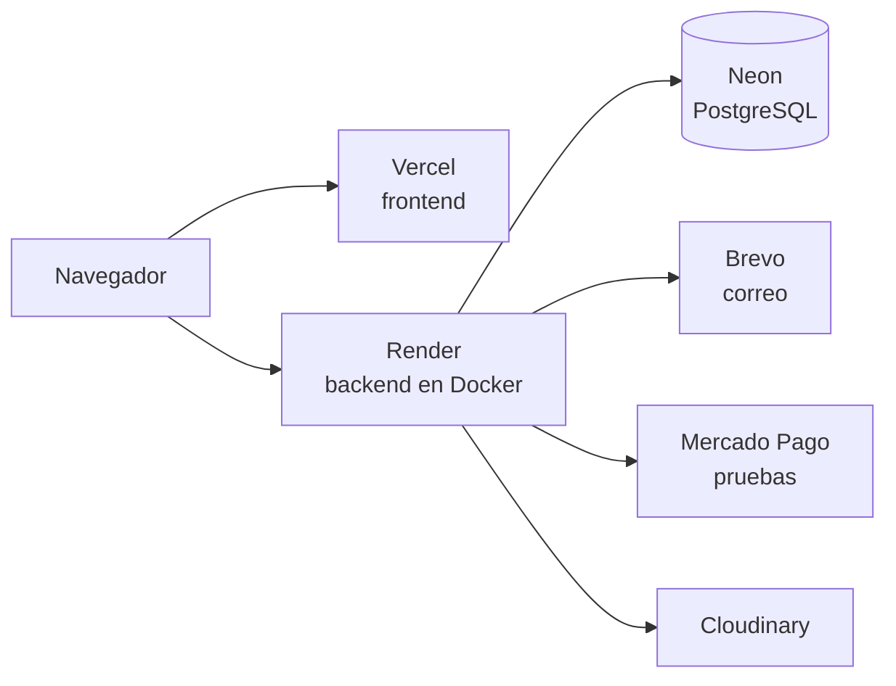

| Dato | Detalle |
|---|---|
| Imagen del backend | `Dockerfile` en dos etapas, usuario sin privilegios, memoria limitada |
| Perfil `prod` | No arranca si faltan variables obligatorias (`ConfiguracionProdValidator`) |
| Rutas del frontend | `vercel.json` manda todo a `index.html` |
| Actualizar | `git push` al repositorio de la demo; antes, correr migraciones nuevas |
| Arranque en frío | 30 a 60 segundos si estuvo inactivo |
| Dinero | Credenciales de prueba: no se mueve dinero real |

**La demo puede estar atrasada respecto del código:** las correcciones del 27/11 todavía no se subieron. Verifíquenlo antes de la defensa.

### Entorno local

| Necesita | Para |
|---|---|
| Java 17, Maven, PostgreSQL | Backend (`mvn spring-boot:run`, puerto 8080) |
| Node 22 | Frontend (`npm run dev`, puerto 5173) |
| MailHog (opcional) | Ver los correos (puerto 8025) |
| Variables de entorno | Mercado Pago y Cloudinary |

### Lo que tenés que saber

- Los tres niveles de prueba y un ejemplo de cada uno.
- Qué corre solo en GitHub y qué no.
- Dónde está cada pieza de la demo.

### Repaso

**1. ¿Que pasen las pruebas significa que no hay errores?**
No. El doble escaneo existía con todo en verde: ninguna prueba lo ejercitaba.

**2. ¿Cómo saben que una prueba sirve?**
Viéndola fallar antes del arreglo.

**3. ¿Qué pasa si falta una variable en producción?**
El backend no arranca y nombra las que faltan.

**4. ¿Aguanta un evento grande?**
No lo medimos. El diseño evita vender de más, pero no hay prueba de carga.

---

## 14. Aspectos éticos y legales

> `docs/proyecto/LEGAL_Y_FISCAL.md` aclara que **no es asesoramiento legal ni contable**. Los trabajos de Derecho y el código de ética de otras materias no forman parte de este proyecto.

### Datos personales

| Qué guardamos | De quién |
|---|---|
| Nombre y email | Compradores |
| Nombre, email y contacto | Organizadores y staff |
| Permisos cifrados de Mercado Pago | Organizadores |
| **Datos de tarjetas: no** | — |

- Norma: **Ley 25.326**; órgano de control, la AAIP.
- Hecho: política de privacidad publicada (`/privacidad`) y aceptación obligatoria al registrarse y al comprar, controlada también en el backend.
- Pendiente: **inscribir la base de datos**, definir cuánto se conservan los datos y revisar la transferencia internacional (los servidores pueden estar fuera del país).

### Defensa del consumidor

- Norma: Ley 24.240 (art. 34) y Código Civil y Comercial (art. 1110): derecho de arrepentimiento.
- Implementado: un botón que **deriva al contacto del organizador**; la plataforma no resuelve ni reembolsa por su cuenta.
- **A validar con un abogado:** si derivar alcanza, quién es el proveedor y si hay excepciones para eventos con fecha.

### Forma jurídica y fiscal

- La plataforma es **intermediaria**: la venta es entre comprador y organizador.
- El organizador factura la entrada; la plataforma, los créditos.
- Pendiente: inscripción, impuestos y condiciones de Mercado Pago para marketplaces (con contador y abogado).

### Términos y condiciones

Publicados (versión `2026-11-20`): intermediación, qué se cobra, cancelaciones y reembolsos, arrepentimiento, uso de la entrada, cuentas y contacto. Se guarda qué versión aceptó cada organizador. Según `DECISIONES.md` (20/11) fueron revisados por un abogado. El equipo lo confirmó el 27/11. Falta actualizar los documentos: la lista de pendientes todavía menciona la reunión y la política de privacidad dice que la conservación de datos "se define con asesoramiento legal". Si preguntan quién y cuándo, respondan solo con lo que sepan.

### Ética

| Tema | Postura |
|---|---|
| Transparencia con el comprador | El cargo se muestra desglosado antes de pagar |
| Datos | Se piden solo los necesarios |
| Auditoría | Registra acciones de usuarios con cuenta; hay que cuidar quién la ve |
| Uso de IA | Permitido por la cátedra, documentado y con revisión humana (sección 6) |
| Honestidad | Se informa lo que no está hecho o probado |

### Lo que tenés que saber

- Intermediaria: qué significa y qué consecuencias tiene.
- Qué datos se guardan y la ley que aplica.
- Hecho frente a pendiente.

### Repaso

**1. ¿Quién devuelve el dinero si se cancela?**
El organizador, desde el panel; el dinero está en su cuenta.

**2. ¿Cumplen la ley de datos personales?**
En parte: hay política y consentimiento; falta inscribir la base y definir la conservación.

**3. ¿El botón de arrepentimiento cumple la norma?**
Cubre la visibilidad; si alcanza con derivar tiene que validarlo un abogado.

---

## 15. Problemas encontrados y cómo se resolvieron

Todos documentados en `DECISIONES.md`, los planes o el historial de Git. Para contarlos: **síntoma → causa → solución → aprendizaje**.

| Fecha | Síntoma | Causa | Solución | Aprendizaje |
|---|---|---|---|---|
| 07/10 | El nombre de usuario no quedaba fijo | Una animación rompía `position: fixed` | Animar solo el contenido | Probar en pantalla |
| 22/10 | Se podían comprar entradas de eventos pasados | Solo se miraba "publicado" | Regla de evento finalizado en un solo lugar | Una regla, un lugar |
| 10/11 | Después de pagar no se volvía al sitio | En local Mercado Pago no muestra el botón | Pagar en otra pestaña mientras la original espera | A veces se rodea la limitación |
| 12/11 | El QR llegaba roto en Gmail | Gmail bloquea imágenes incrustadas como texto | Imagen adjunta en el correo | Probar con el cliente real |
| 12/11 | Contraseñas legibles en la auditoría | Se guardaban todos los parámetros | Enmascarar y limpiar lo viejo | Los registros también filtran datos |
| 12/11 | El límite de intentos se salteaba | Se creía en un encabezado que escribe el cliente | Usar la IP real | No confiar en el cliente |
| 12/11 | Al esperar el pago aparecía "demasiadas solicitudes" | El límite era muy bajo para dos compradores en la misma red | Subirlo y reintentar con calma | La seguridad no debe romper el uso normal |
| 12/11 | Una orden nacía vencida | Reloj de la PC atrasado; además, zona horaria | Corregir el reloj y fijar la zona horaria | El tiempo es una dependencia |
| 16/11 | Reintentar la publicación duplicaba tandas | El asistente las creaba de nuevo | Recordar lo ya creado | Pensar en el reintento |
| 17/11 | Fallaba el pago con la cuenta del organizador | Se usaba el enlace de prueba | Usar el enlace normal | Probado con dinero real; el sandbox sigue sin resolver |
| 20/11 | La firma de los avisos no coincidía | Dos claves (prueba y producción) y un formato viejo sin firma | Aceptar ambas e ignorar el viejo | Mirar los datos antes de suponer |
| Deploy de la demo | No salían los correos | El servidor gratuito bloquea los puertos de Gmail | Brevo | Cada plataforma tiene límites |
| 27/11 | Se llamaba a Mercado Pago con la base abierta | Contra la regla del proyecto | Guardar la orden y llamar fuera | Verificar las reglas, no suponerlas |
| 27/11 | El mismo QR entraba varias veces si se escaneaba a la vez | Leer y guardar por separado | Una sola orden condicionada y prueba que lo reproduce | Probar la concurrencia |

### Los tres para contar

1. **Doble escaneo:** claro, visual y con una prueba.
2. **QR en Gmail:** muestra pruebas reales.
3. **Reintento que duplicaba tandas** o **límite que se salteaba:** muestran criterio.

### Repaso

**1. ¿Cuál fue el problema más difícil?**
Elijan uno que hayan vivido. El cobro con la cuenta del organizador es buen candidato, aclarando que el sandbox no quedó resuelto.

**2. ¿Cómo encontraban los errores?**
Pruebas automáticas, pruebas manuales contra el sistema real, registros y revisión del código contra las reglas.

---

## 16. Estado final, limitaciones y mejoras

### Estado

| Nivel | Qué |
|---|---|
| **Hecho y probado** | Cuentas y roles, eventos y tandas, créditos, compra y emisión con QR, ingreso, venta en puerta, cancelación, anulación, auditoría, notificaciones, ayuda, demo online |
| **Hecho con diferencias respecto de la especificación** | 10 casos de uso (detalle en `PLANIFICADO_VS_CONSTRUIDO.md`) |
| **No hecho** | CU-022, reasignar el rol de un usuario: el equipo lo descartó porque un organizador no pasa a administrador ni un Staff QR a organizador |
| **Hecho pero sin verificar del todo** | Firma obligatoria del webhook con pago real, cobro con OAuth en sandbox, reembolso masivo con varias compras reales |

Casos de uso: **17 coinciden, 10 tienen diferencias, 1 no está.** Digan "27 de 28 implementados" **solo si agregan** lo de las diferencias.

### Limitaciones

| Área | Limitación |
|---|---|
| Uso | Requiere internet; sin aplicación móvil ni modo sin conexión |
| Venta | Sin carrito ni reserva de cupo: en el límite, se paga y se reembolsa |
| Compradores | Sin cuenta ni historial |
| Concurrencia | Faltan proteger la edición de tandas, el saldo de créditos y anular mientras se escanea |
| Reembolsos | Los hechos desde Mercado Pago no anulan las entradas |
| Datos | Dinero como `Double`, pocas claves foráneas, migraciones manuales |
| Operación | Una sola instancia, alojamiento gratuito, sin monitoreo ni copias de seguridad propias |
| Legal | Registro de la base, definiciones fiscales y conservación de datos |

### Mejoras, en orden

| Prioridad | Mejora | Por qué primero |
|---|---|---|
| 1 | Cerrar las carreras pendientes y los reembolsos externos | Afectan cupo, créditos y puerta |
| 2 | Firma obligatoria confirmada, credenciales productivas y rotar las de prueba | Antes de mover dinero real |
| 3 | Flyway, claves foráneas y dinero decimal | Base confiable |
| 4 | Dominio propio, plan pago, monitoreo y copias | Operación |
| 5 | Pendientes legales y fiscales | Para salir a producción |
| 6 | Reserva de cupo, cuentas de comprador, modo sin conexión | Producto |

**30 segundos:** "El sistema cumple el circuito completo, de publicar a ingresar. Para producción faltan cuatro cosas: cerrar casos de concurrencia poco frecuentes, endurecer la configuración de pagos, pasar a migraciones e infraestructura pagas y completar lo legal."

### Lo que tenés que saber

- Los cuatro niveles de estado, sin mezclarlos.
- Tres limitaciones y su mejora, dichas con seguridad.

### Repaso

**1. ¿Está listo para producción?**
No todavía; funciona como demostración. Enumeren lo que falta.

**2. ¿Qué harían con un mes más?**
Las prioridades 1 y 2.

---

## 17. Glosario

| Término | Significado |
|---|---|
| **ACID** | Garantías de una transacción: atomicidad, consistencia, aislamiento y durabilidad |
| **API / API REST** | Forma en que un programa pide cosas a otro; REST usa direcciones y verbos HTTP |
| **Arquitectura en capas** | Separar recibir, decidir y guardar |
| **Autenticación / autorización** | Saber quién sos / qué podés hacer |
| **Backend / frontend** | Lo que corre en el servidor / en el navegador |
| **BCrypt** | Algoritmo para guardar contraseñas como hash |
| **Bloqueo pesimista** | Trabar una fila mientras se usa |
| **Carrera (condición de)** | Error que aparece cuando dos operaciones se cruzan |
| **CI** | Integración continua: pruebas automáticas en cada cambio |
| **CORS** | Regla sobre qué webs pueden llamar a la API desde el navegador |
| **CSRF / XSS** | Actuar con tu sesión desde otra web / inyectar código en la página |
| **CU** | Caso de uso |
| **DTO** | Objeto que define qué entra y sale de la API |
| **Endpoint** | Dirección de la API |
| **Entidad / JPA** | Clase que representa una tabla / estándar para guardarla |
| **Hash / cifrado** | Huella irreversible / dato que se puede recuperar con la clave |
| **HMAC** | Sello calculado con una clave compartida |
| **Idempotente** | Repetir la operación produce un solo efecto |
| **IDOR** | Acceder a datos ajenos cambiando un identificador |
| **JWT** | Token firmado que acredita la sesión |
| **Monolito / microservicios** | Un solo programa / varios independientes |
| **OAuth / PKCE** | Autorizar sin compartir la contraseña / refuerzo de ese proceso |
| **Perfil `prod`** | Configuración de producción de Spring |
| **PK / FK / UK** | Clave primaria / foránea / única |
| **Preferencia** | Pedido de cobro en Mercado Pago |
| **Reconciliación** | Consultar el estado real cuando no llegó el aviso |
| **Responsive** | Que se adapta al tamaño de pantalla |
| **Sandbox** | Entorno de pruebas sin dinero real |
| **SMTP** | Protocolo de envío de correo |
| **SPA** | Aplicación web de una sola página |
| **Tanda** | Grupo de entradas con precio, cupo y ventana de venta |
| **Transacción** | Cambios que se aplican todos o ninguno |
| **UUID** | Identificador al azar prácticamente irrepetible |
| **Webhook** | Aviso automático de un servicio a otro |

---

*Fin de la guía.*
